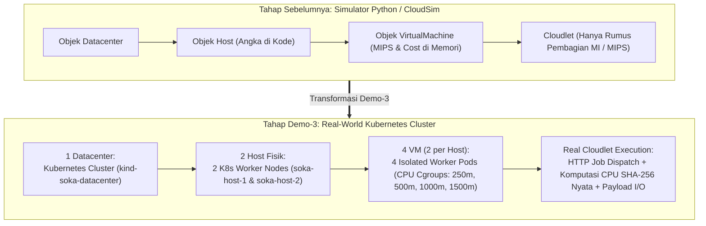

# 🚀 BRIEFING LENGKAP TIM KELOMPOK 4 — DEMO 3: REAL-WORLD HEURISTIC CLOUD TASK SCHEDULING (KUBERNETES)

> **Dokumen Briefing & AI Agent Context — Mata Kuliah Strategi Optimasi Komputasi Awan (SOKA) 2026**
> - **Institusi**: Departemen Teknologi Informasi, FTEIC — Institut Teknologi Sepuluh Nopember (ITS), Surabaya
> - **Dosen Pengampu**: Dr. Ir. Henning Titi Ciptaningtyas, S.Kom., M.Kom.
> - **Repositori Simulasi Sebelumnya**: [https://github.com/HikariReiziq/Heuristic-Task-Scheduling-Algorithm](https://github.com/HikariReiziq/Heuristic-Task-Scheduling-Algorithm)
> - **TargetRepositori Baru (Demo-3)**: `SOKA-RealWorld-Sufferage-K8s` *(Silakan dibuat oleh PIC GitHub Tim)*
> - **Dokumen Pasangan**: Wajib digunakan bersama file **`PRD_REALWORLD_SUFFERAGE_K8S.md`**

---

## 📋 DAFTAR ISI
1. [Konteks Tugas Demo-3 & Mengapa Kita Memilih Kubernetes Lokal Multi-Node](#1-konteks-tugas-demo-3--mengapa-kita-memilih-kubernetes-lokal-multi-node)
2. [Pemaparan Lengkap Konsep & Matematika Algoritma Sufferage (Wajib Paham untuk Presentasi)](#2-pemaparan-lengkap-konsep--matematika-algoritma-sufferage-wajib-paham-untuk-presentasi)
3. [Strategi Pemangkasan: Fokus pada 3 Algoritma Inti Saja](#3-strategi-pemangkasan-fokus-pada-3-algoritma-inti-saja)
4. [Pembagian Tugas 5 Anggota Kelompok 4 & Instruksi Pembuatan GitHub Baru](#4-pembagian-tugas-5-anggota-kelompok-4--instruksi-pembuatan-github-baru)
5. [Protokol Wajib `MEMORY.md` (Agar Tim & AI Agent Selalu Sinkron)](#5-protokol-wajib-memorymd-agar-tim--ai-agent-selalu-sinkron)
6. [Panduan Instalasi Kubernetes (`Docker` + `kubectl` + `kind`) Lintas OS](#6-panduan-instalasi-kubernetes-docker--kubectl--kind-lintas-os)
7. [Master Prompt Siap Pakai (Copy-Paste ke AI Agent Teman Kelompok)](#7-master-prompt-siap-pakai-copy-paste-ke-ai-agent-teman-kelompok)

---

## 1. Konteks Tugas Demo-3 & Mengapa Kita Memilih Kubernetes Lokal Multi-Node

### 1.1 Apa yang Diminta pada Demo-3?
Pada tugas sebelumnya, kita telah menyelesaikan **Simulasi Cloud Task Scheduling** menggunakan Python/CloudSim (tersimpan di repo `Heuristic-Task-Scheduling-Algorithm`). Sekarang, untuk **Demo - 3 (Presentasi Real-World & Pengumpulan Dokumen Akhir)**, instruksi dosen adalah:
1. **Implementasi di Lingkungan Real-World Cloud**: Wajib menggunakan salah satu dari **Proxmox / Kubernetes / AWS / GCP**.
2. **Syarat Topologi Infrastruktur Minimum**:
   - Minimal **1 Datacenter**
   - Minimal **2 Host**
   - Minimal **2 VM per Host** (Total minimal **4 VM**)
3. **Implementasi Algoritma Heuristik Pilihan Kelompok**: Mengimplementasikan algoritma **Sufferage** yang kemarin kita buat di simulator ke atas infrastruktur dunia nyata tersebut, menjalankan dataset uji, dan mengumpulkan **Dokumen Laporan Akhir**.

### 1.2 Mengapa Kita Memilih Full Kubernetes Multi-Node (`kind` - Kubernetes in Docker)?
Setelah mengevaluasi opsi **AWS EC2 (kredit $99)** vs **Kubernetes (`kind`)**, kita memutuskan menggunakan **Full Kubernetes Multi-Node (`kind`)** dengan alasan strategis berikut:
1. **100% Memenuhi Syarat "Real-World Cloud" dari Dosen**: Kubernetes adalah standar industri orkestrasi cloud modern. Dengan `kind` (*Kubernetes in Docker*), kita membangun cluster Kubernetes multi-node sungguhan yang dikontrol penuh dengan `kubectl`.
2. **Biaya $0 & Aman Selama 1 Minggu Pengerjaan**: Tidak ada risiko kredit AWS habis karena lupa mematikan instance EC2 atau biaya transfer jaringan membengkak saat semua anggota kelompok melakukan *testing* berulang-ulang.
3. **Bisa Dijalankan di Laptop Semua Anggota Tim & Anti-Gagal Saat Demo Kelas**: Tidak bergantung pada kestabilan Wi-Fi kampus atau latensi SSH ke server luar negeri saat live demo di depan dosen.
4. **Penegakan Kecepatan CPU Nyata (*Real Linux `cgroups` Throttling*)**: Setiap VM direpresentasikan sebagai *Isolated Worker Pod* yang dipetakan ke Host tertentu (`nodeSelector`) dan dibatasi jatah CPU fisiknya oleh kernel Linux (`resources.limits.cpu`: `250m`, `500m`, `1000m`, `1500m`). Ketika sebuah task dikirim ke VM-1 (`250m` / 0.25 Core), waktu eksekusi fisiknya di dunia nyata benar-benar **6x lebih lambat** dibandingkan jika dikirim ke VM-4 (`1500m` / 1.5 Core)!

### 1.3 Pemetaan Arsitektur Simulasi ke Real-World Kubernetes



---

## 2. Pemaparan Lengkap Konsep & Matematika Algoritma Sufferage (Wajib Paham untuk Presentasi)

Bagian ini merangkum konsep inti **Algoritma Sufferage** yang wajib dipahami oleh seluruh anggota Kelompok 4 saat sesi tanya-jawab presentasi maupun saat menulis dokumen akhir.

### 2.1 Apa Itu Masalah Penjadwalan Task di Cloud Heterogen?
Di lingkungan cloud heterogen, kita memiliki:
- Sekumpulan **Task / Cloudlet** independen $T = \{T_1, T_2, \dots, T_n\}$, di mana tiap task $T_i$ memiliki beban instruksi komputasi **$MI_i$** (*Million Instructions*) dan ukuran transfer data **$Mb_i$** (*Megabits*).
- Sekumpulan **Virtual Machine (VM)** heterogen $V = \{VM_1, VM_2, \dots, VM_m\}$, di mana tiap $VM_j$ memiliki kecepatan CPU **$MIPS_j$**, kapasitas bandwidth **$Mbps_j$**, dan tarif biaya sewa **$CostRate_j$** (INR per MI).

Karena jumlah kombinasi pemetaan mencapai $m^n$ (masalah **NP-Hard**), kita membutuhkan **Algoritma Heuristik** yang mampu mengambil keputusan penjadwalan secara cepat (polinomial) tanpa harus mencoba seluruh kemungkinan.

### 2.2 Rumus Dasar Waktu & Biaya (Matriks ETC dan ECC)
Sebelum menjadwalkan task, broker menghitung dua matriks dasar berukuran $n \times m$:

1. **Expected Time to Compute ($ETC_{ij}$)** — Estimasi waktu eksekusi task $T_i$ jika dijalankan pada $VM_j$:
   $$ETC_{ij} = \underbrace{\left(\frac{MI_i}{MIPS_j}\right)}_{\text{Waktu Komputasi CPU}} + \underbrace{\left(\frac{Mb_i}{Mbps_j}\right)}_{\text{Waktu Transfer Data}}$$

2. **Completion Time ($CT_{ij}$)** — Waktu selesai task $T_i$ pada $VM_j$ dengan memperhitungkan antrean pekerjaan sebelumnya (*Ready Time* $RT_j$ pada $VM_j$):
   $$CT_{ij} = ETC_{ij} + RT_j$$

3. **Expected Cost to Compute ($ECC_{ij}$) & Completion Cost ($CC_{ij}$)** — Biaya finansial untuk mengeksekusi task $T_i$ pada $VM_j$:
   $$ECC_{ij} = MI_i \times CostRate_j$$
   $$CC_{ij} = ECC_{ij} + RC_j$$
   *(di mana $RC_j$ adalah Ready Cost / akumulasi biaya yang sudah berjalan di $VM_j$)*.

---

### 2.3 Algoritma 1: Standard Sufferage (Maheswaran dkk., JPDC 1999)

#### 💡 Filosofi "Sufferage" (Derajat Penderitaan)
Mengapa algoritma seperti **Min-Min** sering gagal pada sistem heterogen? Karena Min-Min selalu mendahulukan task kecil yang cepat selesai. Akibatnya, task-task besar atau task yang hanya cocok di satu VM tertentu terpaksa mengalah dan akhirnya dieksekusi di VM lambat, membuat waktu total (*Makespan*) membengkak.

**Maheswaran dkk. (1999)** memperkenalkan konsep **Sufferage**:
> *"Jika sebuah task $T_i$ TIDAK diberikan kepada VM terbaik pertamanya (tercepat ke-1), seberapa parah task tersebut akan **menderita** (tertunda) jika harus pindah ke VM terbaik keduanya (tercepat ke-2)?"*

#### 📐 Langkah Algoritma Standard Sufferage:
1. Untuk setiap task $T_i$ yang belum dijadwalkan, cari dua nilai pada baris $CT_i$:
   - **$FMICT_i$ (*First Minimum Completion Time*)**: Waktu selesai paling cepat (terbaik ke-1) pada VM terbaik $j^*$.
   - **$SMICT_i$ (*Second Minimum Completion Time*)**: Waktu selesai tercepat kedua (terbaik ke-2).
2. Hitung **Sufferage Value of Completion Time ($SVCT_i$)**:
   $$SVCT_i = SMICT_i - FMICT_i$$
   *(Semakin besar nilai $SVCT_i$, semakin besar kerugian waktu yang diderita task $T_i$ jika tidak mendapatkan VM terbaiknya $j^*$)*.
3. **Resolusi Konflik Perebutan VM**:
   - Setiap task mengajukan "proposal" ke VM tercepat pertamanya ($j^*$).
   - Jika suatu VM hanya diminta oleh 1 task, VM tersebut langsung diberikan ke task itu.
   - **Jika ada beberapa task yang berebut VM terbaik yang sama**, maka **task dengan nilai Sufferage ($SVCT_i$) paling tinggi yang menang!** Task yang kalah akan dievaluasi ulang pada iterasi berikutnya.
4. Perbarui *Ready Time* ($RT_{j^*}$) pada VM yang baru saja menerima task, lalu ulangi hingga semua task terjadwal.

#### 📊 Contoh Ilustrasi Cepat (Untuk Dijelaskan Saat Presentasi):
Misalkan ada 2 Task ($T_1, T_2$) yang sama-sama menginginkan $VM_{\text{cepat}}$:
- **Task 1 ($T_1$)**: di $VM_{\text{cepat}}$ selesai **2 detik**, di $VM_{\text{lambat}}$ selesai **10 detik** $\rightarrow$ **Sufferage $SVCT_1 = 10 - 2 = 8$ detik**.
- **Task 2 ($T_2$)**: di $VM_{\text{cepat}}$ selesai **1.5 detik**, di $VM_{\text{lambat}}$ selesai **2.5 detik** $\rightarrow$ **Sufferage $SVCT_2 = 2.5 - 1.5 = 1$ detik**.
- **Keputusan Min-Min**: Akan memilih $T_2$ duluan (karena 1.5 detik < 2 detik), sehingga $T_1$ terlempar ke $VM_{\text{lambat}}$ dan Makespan menjadi **10 detik**!
- **Keputusan Sufferage**: Memilih **$T_1$** untuk masuk ke $VM_{\text{cepat}}$ karena $T_1$ memiliki penderitaan jauh lebih besar ($SVCT_1 = 8 > SVCT_2 = 1$), sementara $T_2$ pindah ke $VM_{\text{lambat}}$ dan selesai dalam **2.5 detik**. Hasilnya: **Makespan turun drastis dari 10 detik menjadi 2.5 detik!**

---

### 2.4 Algoritma 2: CCTSA — Cost and Completion Time based Sufferage Algorithm (Krishnaveni dkk., IJRECE 2019)

#### 💡 Kelemahan Sufferage Klasik & Solusi Dual-Sufferage CCTSA
Pada cloud komersial (AWS, GCP, Azure), VM yang paling cepat ($MIPS$ tinggi) selalu memiliki tarif sewa ($CostRate$) paling mahal. **Standard Sufferage bersifat *Cost-Blind* (buta biaya)**: ia hanya memikirkan waktu selesai tanpa peduli tagihan cloud membengkak.

Oleh karena itu, Kelompok 4 mengadopsi **CCTSA (Krishnaveni dkk., 2019)** yang memperluas Sufferage menjadi **Dual-Sufferage (Dua Fungsi Objektif: Waktu & Biaya)**:

#### 📐 Langkah Algoritma CCTSA:
1. Untuk setiap task $T_i$ yang belum dijadwalkan, hitung dua dimensi sufferage:
   - **Sufferage Waktu ($SVCT_i$)**: Selisih waktu selesai minimum ke-2 dan ke-1:
     $$SVCT_i = SMICT_i - FMICT_i$$
   - **Sufferage Biaya ($SVC_i$)**: Selisih biaya penyelesaian maksimum ke-1 ($FMXC_i$) dan maksimum ke-2 ($SMXC_i$):
     $$SVC_i = FMXC_i - SMXC_i$$
2. **Kriteria Pemilihan Task Prioritas ($Ch\_Task$)**:
   - Pindai daftar task yang belum terjadwal dan pilih task yang memenuhi kondisi urgensi ganda:
     $$(SVCT_i > FMICT_i) \quad \mathbf{AND} \quad (SVC_i < FMXC_i)$$
   - **Aturan Fallback**: Jika pada suatu putaran tidak ada task yang memenuhi syarat ketat di atas secara bersamaan, pilih task dengan skor gabungan sufferage ternormalisasi tertinggi:
     $$\text{CombinedSufferage}_i = \frac{SVCT_i}{FMICT_i + \epsilon} + \frac{SVC_i}{FMXC_i + \epsilon}$$
3. **Pemilihan VM Secara Multi-Objektif (Menyeimbangkan Waktu & Biaya)**:
   - Task terpilih ($Ch\_Task$) ditugaskan ke $VM_j$ yang meminimalkan skor gabungan waktu dan biaya:
     $$\text{Score}_j = w_{\text{time}} \cdot \left(\frac{CT_{i,j}}{\max_k CT_{i,k}}\right) + w_{\text{cost}} \cdot \left(\frac{CC_{i,j}}{\max_k CC_{i,k}}\right)$$
     *(Default bobot seimbang: $w_{\text{time}} = 0.5$ dan $w_{\text{cost}} = 0.5$)*.
4. Perbarui *Ready Time* ($RT_j$) dan *Ready Cost* ($RC_j$) pada $VM_j$, lalu ulangi sampai seluruh task teralokasi.

---

## 3. Strategi Pemangkasan: Fokus pada 3 Algoritma Inti Saja

Di repositori simulasi sebelumnya kita memiliki 5 algoritma. Namun, untuk **Real-World Kubernetes (Demo-3)**, setiap task benar-benar mengeksekusi komputasi CPU di dalam container Pod. Agar eksekusi *benchmark* saat live demo berjalan cepat (~15–25 detik), kode bersih, dan analisis laporan akhir tajam, kita **hanya mengimplementasikan 3 algoritma paling esensial**:

| No | Algoritma | Peran dalam Demo-3 & Laporan Akhir | Fungsi Objektif |
| :-: | :--- | :--- | :--- |
| **1** | **CCTSA (*Proposed*)** | Algoritma unggulan Kelompok 4 (Dual-Sufferage) yang membuktikan penghematan biaya cloud sekaligus menjaga performa waktu. | **Multi-Objektif**: Minimasi *Makespan* + Minimasi *Total Cost* |
| **2** | **Standard Sufferage** | Algoritma Sufferage murni (Maheswaran 1999) sebagai pembuktian keampuhan mekanisme resolusi konflik Sufferage di atas VM heterogen. | **Single-Objektif**: Minimasi *Makespan* & Pemerataan Beban (*DI*) |
| **3** | **Round Robin (RR)** | Baseline penjadwal statis (siklik bergiliran tanpa melihat spesifikasi VM) untuk menunjukkan kondisi *Before vs After* penggunaan heuristik Sufferage. | Statis (Tanpa Optimasi) |

---

## 4. Pembagian Tugas 5 Anggota Kelompok 4 & Timeline Sprint (Senin–Rabu Coding, Kamis Testing)

### 4.1 Pembagian Jobdesk Tim (SOKA Kelompok 4)

| No | Nama Anggota | NRP | Jobdesk Utama (Demo-3 Real-World) | Modul / File yang Dikerjakan |
| :-: | :--- | :---: | :--- | :--- |
| **1** | **M. Hikari Reiziq Rakhmadinta (Hikari)** | `5027241079` | **Siapin Provider Cloud & Briefing**: Menyiapkan konsep provider cloud Kubernetes, menyusun dokumen Briefing, PRD, dan protokol `MEMORY.md` untuk tim. | `BRIEFING_TIM_KELOMPOK4_DEMO3.md`, `PRD_REALWORLD_SUFFERAGE_K8S.md`, `MEMORY.md` |
| **2** | **I Dewa Made Satya Raditya (Mas Satya)** | `5027231051` | **Bikin GitHub & Coding Inisialisasi 1 DC, 2 Host, dan 2 VM/Host**: Membuat repo GitHub baru serta membangun infrastruktur Kubernetes 1 Datacenter, 2 Host, 4 VM Pods (2 VM/Host) & microservice VM Worker. | Repo GitHub Baru, `k8s/kind-cluster.yaml`, `k8s/vm-pods.yaml`, `vm_worker/worker_server.py`, `vm_worker/Dockerfile`, `scripts/setup_cluster.sh` |
| **3** | **Muhammad Rakha Hananditya Rauf (Rakha)** | `5027241015` | **Implementasi Algoritma Sufferage**: Mengimplementasikan algoritma Standard Sufferage, CCTSA (Dual-Sufferage), dan Round Robin beserta K8s Broker & Dataset. | `scheduler/models.py`, `scheduler/datasets.py`, `scheduler/algorithms.py`, `scheduler/k8s_broker.py`, `run_benchmark.py` |
| **4** | **Ahmad Wildan Fawwaz (Wildan Fawwaz)** | `5027241001` | **Testing Kalau Ada Error & Persiapan Demo**: Melakukan integrasi, debugging/fixing jika ada error di cluster/kode, menjalankan automated test, serta menyiapkan Live Dashboard untuk Demo. | `tests/test_scheduler.py`, `dashboard/server.py`, `dashboard/index.html`, End-to-End Verification |
| **5** | **Theodorus Aaron Ugraha (Aron)** | `5027241056` | **Laporan Algoritma Sufferage**: Merekap hasil eksperimen Simulasi vs Real-World Kubernetes, tabel/grafik 5 metrik, dan menyusun Dokumen Laporan Akhir Demo-3. | `results/realworld_summary.json`, `docs/LAPORAN_AKHIR_DEMO3_KELOMPOK4.md`, `README.md` |

### 4.2 Jadwal Eksekusi 3 Hari (Senin – Rabu) + Kamis Khusus Testing & Demo

| Hari / Tanggal | Fokus Target | PIC Utama | Deliverable |
| :--- | :--- | :--- | :--- |
| **Hari 1 (Senin, 26 Okt)** | **Cloud Provider Prep, Buat GitHub & Inisialisasi 1 DC, 2 Host, 4 VM** | **Hikari** & **Mas Satya** | Briefing & PRD siap (`[x]`), Repo GitHub baru aktif, cluster Kubernetes `1 DC, 2 Host, 4 VM` menyala (`Running`). |
| **Hari 2 (Selasa, 27 Okt)** | **Implementasi Algoritma Sufferage & Broker Real-World** | **Rakha** | Modul `scheduler/` (`CCTSA`, `Standard Sufferage`, `Round Robin`) & `run_benchmark.py` berhasil mengirim task ke 4 VM Pod. |
| **Hari 3 (Rabu, 28 Okt)** | **Penyusunan Laporan Akhir & Integrasi Demo** | **Aron** & **Wildan Fawwaz** | Draft lengkap Laporan Akhir Algoritma Sufferage (`docs/LAPORAN_AKHIR_DEMO3_KELOMPOK4.md`) & Dashboard Demo siap. |
| **Hari 4 (Kamis, 29 Okt)** | **FULL TESTING, Fix Error & Gladi Bersih Demo** | **Wildan Fawwaz** & **Seluruh Tim** | **Khusus Testing Saja** (tidak ada tambah fitur baru): uji kelancaran live demo, pastikan 0 error, dan siap presentasi! |

### 4.3 Instruksi Pembuatan Repository GitHub Baru (Oleh Mas Satya)
**Mas Satya** silakan melakukan langkah inisialisasi GitHub berikut:
1. Buka GitHub dan buat repository baru dengan nama:
   **`SOKA-RealWorld-Sufferage-K8s`**
2. Undang ke-4 anggota Kelompok 4 lainnya (**Hikari, Rakha, Wildan Fawwaz, Aron**) sebagai **Collaborators** (`Settings -> Collaborators -> Add people`).
3. Clone repository tersebut ke komputer lokal, lalu **masukkan 3 file awal berikut ke root repository**:
   - `BRIEFING_TIM_KELOMPOK4_DEMO3.md` (file ini)
   - `PRD_REALWORLD_SUFFERAGE_K8S.md` (file PRD pasangan)
   - `MEMORY.md` (file pelacak progres)
4. Lakukan commit pertama:
   ```bash
   git add BRIEFING_TIM_KELOMPOK4_DEMO3.md PRD_REALWORLD_SUFFERAGE_K8S.md MEMORY.md
   git commit -m "chore: init project with Briefing, PRD, and MEMORY tracker"
   git push -u origin main
   ```

---

## 5. Protokol Wajib `MEMORY.md` (Agar Tim & AI Agent Selalu Sinkron)

### 5.1 Mengapa Harus Ada File `MEMORY.md` di GitHub?
Karena proyek ini dikerjakan secara estafet dalam **3 hari (Senin–Rabu) + Kamis Testing** oleh 5 orang menggunakan bantuan AI Agent masing-masing, setiap AI Agent membutuhkan **rekam jejak status proyek terkini** (*Single Source of Truth*) agar:
- AI Agent tahu pekerjaan siapa yang **sudah selesai (`[x]`)**, **sedang dikerjakan (`[~]`)**, atau **belum dikerjakan (`[ ]`)**.
- Tidak terjadi duplikasi kerja atau perubahan konfigurasi port/nama pod secara sepihak.

### 5.2 Aturan Wajib Penggunaan `MEMORY.md`
1. **SEBELUM Mulai Kerja**: Jalankan `git pull`, lalu perintahkan AI Agent Anda untuk membaca `MEMORY.md` terlebih dahulu.
2. **SETELAH Selesai Mengerjakan Modul/Fitur**: Perintahkan AI Agent Anda untuk memperbarui checklist, tabel status komponen, dan menambahkan baris baru pada bagian **Session / Commit Log** di `MEMORY.md` sebelum melakukan `git commit` dan `git push`.

### 5.3 Template Awal `MEMORY.md` (Sudah Disiapkan di File `MEMORY.md`)

```markdown
# 🧠 MEMORY.md — Project State & Progress Tracker (SOKA Kelompok 4 Demo-3)

> **INSTRUKSI WAJIB UNTUK MANUSIA & AI CODING AGENT**:
> 1. **BACA FILE INI TERLEBIH DAHULU** setiap kali memulai sesi pengerjaan baru.
> 2. **JANGAN MENGUBAH** kontrak port (`30081`–`30084`, `8090`), nama node Kubernetes (`host-1`, `host-2`), maupun nama Pod VM (`vm-1-small` s.d. `vm-4-xlarge`) tanpa memperbarui dokumen ini.
> 3. **WAJIB UPDATE FILE INI** (ubah status `[ ]` menjadi `[x]` dan tambahkan entri di *Progress Log*) setiap kali selesai membangun, memperbaiki, atau menguji suatu fitur sebelum `git commit & push`.

---

## 📌 1. Pembagian Jobdesk & Jadwal (Senin–Rabu Pengerjaan, Kamis Testing)
1. **Hikari (`5027241079`)**: Siapin Provider Cloud & Briefing (`BRIEFING`, `PRD`, `MEMORY.md`) — **[x] Selesai (Senin)**
2. **Mas Satya (`5027231051`)**: Bikin GitHub Baru & Coding Inisialisasi 1 DC, 2 Host, dan 2 VM/Host (`k8s/`, `vm_worker/`, `scripts/`) — **[ ] Target Senin**
3. **Rakha (`5027241015`)**: Implementasi Algoritma Sufferage & K8s Broker (`scheduler/`, `run_benchmark.py`) — **[ ] Target Selasa**
4. **Aron (`5027241056`)**: Laporan Akhir Algoritma Sufferage (`docs/LAPORAN_AKHIR_DEMO3_KELOMPOK4.md`, `results/`) — **[ ] Target Rabu**
5. **Wildan Fawwaz (`5027241001`)**: Testing Kalau Ada Error, Dashboard & Persiapan Demo (`tests/`, `dashboard/`) — **[ ] Target Rabu & Kamis (Full Testing)**

---

## ✅ 2. Checklist Progres Pembangunan Komponen

### Fase 1: Persiapan Provider Cloud & Briefing (PIC: Hikari — Senin)
- [x] Evaluasi provider cloud (Keputusan: Full Kubernetes Multi-Node via `kind`)
- [x] Pembuatan `BRIEFING_TIM_KELOMPOK4_DEMO3.md`, `PRD_REALWORLD_SUFFERAGE_K8S.md`, dan `MEMORY.md`

### Fase 2: Buat GitHub & Inisialisasi 1 DC, 2 Host, 2 VM/Host (PIC: Mas Satya — Senin)
- [ ] Pembuatan repository GitHub baru `SOKA-RealWorld-Sufferage-K8s` & push ke-3 dokumen utama
- [ ] Pembuatan `k8s/kind-cluster.yaml` (1 Datacenter Control Plane + 2 Worker Host Nodes `host-1` & `host-2`)
- [ ] Pembuatan `k8s/vm-pods.yaml` (Namespace `soka-cloud`, 4 VM Pods — 2 VM per Host dengan `nodeSelector` & `resources.limits.cpu`)
- [ ] Pembuatan `vm_worker/worker_server.py` & `vm_worker/Dockerfile`
- [ ] Pembuatan `scripts/install_k8s_tools.sh` & `scripts/setup_cluster.sh`

### Fase 3: Implementasi Algoritma Sufferage & Broker (PIC: Rakha — Selasa)
- [ ] Pembuatan `scheduler/models.py` (Model `Task`, `VMNode`, `TaskAllocation`, `BenchmarkResult`)
- [ ] Pembuatan `scheduler/datasets.py` (Skenario 1: 10 Task Paper Krishnaveni & Skenario 2: 24 Task GoCJ/Tugas 2A)
- [ ] Pembuatan `scheduler/algorithms.py` (`CCTSAScheduler`, `StandardSufferageScheduler`, `RoundRobinScheduler`)
- [ ] Pembuatan `scheduler/k8s_broker.py` & `run_benchmark.py`

### Fase 4: Testing Error, Live Dashboard & Persiapan Demo (PIC: Wildan Fawwaz — Rabu & Kamis)
- [ ] Pembuatan `tests/test_scheduler.py` & debugging jika ada error pada integrasi K8s / port NodePort
- [ ] Pembuatan `dashboard/server.py` & `dashboard/index.html` untuk Live Demo
- [ ] Full End-to-End Testing & Gladi Bersih Demo pada hari Kamis

### Fase 5: Laporan Akhir Algoritma Sufferage (PIC: Aron — Rabu & Kamis)
- [ ] Pengambilan data hasil eksperimen (`results/realworld_summary.json`) & screenshot bukti `kubectl`
- [ ] Penyusunan `docs/LAPORAN_AKHIR_DEMO3_KELOMPOK4.md` & `README.md` utama
```

---

## 6. Panduan Instalasi Kubernetes (`Docker` + `kubectl` + `kind`) Lintas OS

Untuk menjalankan cluster **1 Datacenter, 2 Host, dan 4 VM** di komputer masing-masing, setiap anggota tim hanya membutuhkan 3 komponen ringan: **Docker**, **`kubectl`** (CLI resmi Kubernetes), dan **`kind`** (*Kubernetes in Docker*).

### 6.1 Pengguna Linux (Fedora / Ubuntu / Debian / Arch)
1. **Pastikan Docker sudah berjalan**:
   ```bash
   docker info
   # Jika belum menyala: sudo systemctl enable --now docker
   ```
2. **Instal `kubectl` dan `kind` secara otomatis ke `~/.local/bin` (Tanpa perlu sudo/root)**:
   ```bash
   mkdir -p ~/.local/bin
   export PATH="$HOME/.local/bin:$PATH"

   # 1. Unduh kubectl terbaru (Linux x86_64)
   K8S_VER=$(curl -L -s https://dl.k8s.io/release/stable.txt)
   curl -Lo ~/.local/bin/kubectl "https://dl.k8s.io/release/${K8S_VER}/bin/linux/amd64/kubectl"
   chmod +x ~/.local/bin/kubectl

   # 2. Unduh kind terbaru (Linux x86_64)
   curl -Lo ~/.local/bin/kind https://kind.sigs.k8s.io/dl/v0.27.0/kind-linux-amd64
   chmod +x ~/.local/bin/kind

   # 3. Verifikasi instalasi
   kubectl version --client
   kind version
   ```

### 6.2 Pengguna Windows 10/11 (Menggunakan Docker Desktop + PowerShell / WSL2)
1. Pastikan **Docker Desktop** sudah terinstal dan berstatus *Engine Running*.
2. Buka **PowerShell** atau **Terminal WSL2** dan jalankan:
   ```powershell
   # Jika di PowerShell Windows:
   winget install -e --id Kubernetes.kubectl
   winget install -e --id Kubernetes.kind

   # Verifikasi:
   kubectl version --client
   kind version
   ```
   *(Jika menggunakan terminal Ubuntu di dalam WSL2, cukup gunakan perintah Linux pada poin 6.1 di atas!)*

### 6.3 Pengguna macOS (Apple Silicon M1/M2/M3 atau Intel)
1. Pastikan **Docker Desktop** atau **OrbStack** sudah berjalan.
2. Buka Terminal dan jalankan melalui Homebrew:
   ```bash
   brew install kubectl kind
   kubectl version --client
   kind version
   ```

### 6.4 Perintah Verifikasi Saat Cluster Sudah Dibangun
Setelah script `./scripts/setup_cluster.sh` dijalankan, Anda dapat membuktikan kepada dosen saat Demo-3 bahwa infrastruktur memiliki **1 Datacenter, 2 Host, dan 2 VM per Host (Total 4 VM)** dengan 2 perintah berikut:
```bash
# 1. Bukti 1 Datacenter (Control Plane) & 2 Host Fisik (soka-datacenter-worker & worker2):
kubectl get nodes -o wide --show-labels

# 2. Bukti 4 VM Heterogen (2 VM di Host-1, 2 VM di Host-2):
kubectl get pods -n soka-cloud -o wide
```

---

## 7. Master Prompt Siap Pakai (Copy-Paste ke AI Agent Teman Kelompok)

Teman-teman Kelompok 4 cukup meletakkan file **`BRIEFING_TIM_KELOMPOK4_DEMO3.md`** dan **`PRD_REALWORLD_SUFFERAGE_K8S.md`** (beserta **`MEMORY.md`**) di dalam folder kerja repositori GitHub baru, lalu **copy-paste prompt di bawah ini** ke AI Agent mereka (Claude Code, Cursor, Antigravity, Windsurf, dll.):

```text
Halo AI Agent! Saya adalah anggota Kelompok 4 mata kuliah Strategi Optimasi Komputasi Awan (SOKA) ITS.
Tolong baca secara menyeluruh 3 file di workspace ini terlebih dahulu:
1. BRIEFING_TIM_KELOMPOK4_DEMO3.md (Konteks tim, rumus algoritma Sufferage & CCTSA, protokol kerja, dan instalasi Kubernetes)
2. PRD_REALWORLD_SUFFERAGE_K8S.md (Product Requirements Document lengkap beserta arsitektur dan blueprint seluruh kode program yang harus dibangun)
3. MEMORY.md (Status progres pengerjaan proyek saat ini — jika belum ada, buatkan dari template di BRIEFING_TIM_KELOMPOK4_DEMO3.md)

Tugas Anda saat ini:
1. Periksa MEMORY.md untuk melihat komponen mana yang belum selesai ([ ]).
2. Pastikan tools Kubernetes (`kubectl` dan `kind`) sudah terinstal di komputer saya (jika belum, jalankan instalasi sesuai panduan di BRIEFING_TIM_KELOMPOK4_DEMO3.md).
3. Bangun seluruh file dan kode program sesuai spesifikasi dan blueprint yang ada di PRD_REALWORLD_SUFFERAGE_K8S.md (mulai dari folder `k8s/`, `vm_worker/`, `scheduler/`, `dashboard/`, `scripts/`, `tests/`, hingga `docs/`).
4. Jalankan `./scripts/setup_cluster.sh` untuk men-deploy cluster Kubernetes Multi-Node (1 Datacenter, 2 Host Node, 4 VM Worker Pods), lalu jalankan `python3 run_benchmark.py` dan unit test `python3 -m unittest discover -s tests` untuk memverifikasi bahwa ketiga algoritma (CCTSA, Standard Sufferage, dan Round Robin) berhasil mengeksekusi task secara nyata di atas Pod Kubernetes.
5. Setelah semua terverifikasi berjalan lancar, perbarui checklist dan log progres di `MEMORY.md` serta siapkan laporan akhirnya di `docs/LAPORAN_AKHIR_DEMO3_KELOMPOK4.md`.
```
