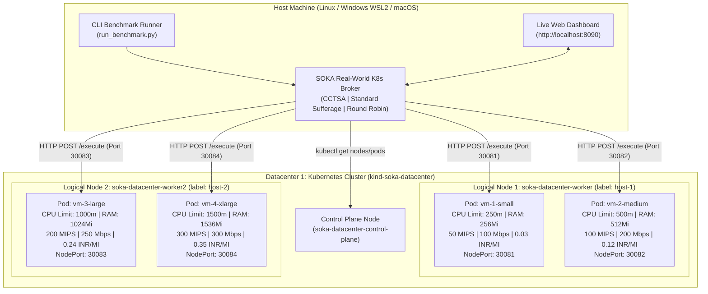

# 📄 PRODUCT REQUIREMENTS DOCUMENT (PRD) & TECHNICAL BLUEPRINT
## Real-World Heuristic Cloud Task Scheduling (Sufferage & CCTSA) on Multi-Node Kubernetes

> **Status implementasi (28 Oktober 2026):** Bagian blueprint kode pada dokumen
> ini adalah rancangan awal dan bukan lagi sumber implementasi. Implementasi
> terverifikasi berada di `scheduler/`, `vm_worker/`, `k8s/`, dan
> `run_benchmark.py`; metode serta hasil aktual dijelaskan di `README.md`.
> Koreksi utama: node `kind` adalah node logis berbasis container, worker adalah
> Pod (bukan VM hardware), Standard Sufferage mengikuti Figure 2 Maheswaran,
> dan CCTSA tidak memakai weighted score/fallback gabungan yang tidak ada pada
> paper.

| Atribut Dokumen | Detail Spesifikasi |
| :--- | :--- |
| **Nama Produk / Proyek** | **SOKA Real-World Heuristic Cloud Scheduler (`SOKA-RealWorld-Sufferage-K8s`)** |
| **Tahap Tugas** | **Demo - 3**: Implementasi Real-World Cloud & Pengumpulan Dokumen Akhir |
| **Mata Kuliah / Kelas** | Strategi Optimasi Komputasi Awan (SOKA) — Kelas C (2026) |
| **Dosen Pengampu** | Dr. Ir. Henning Titi Ciptaningtyas, S.Kom., M.Kom. |
| **Tim Pengembang (Kelompok 4)** | 1. **M. Hikari Reiziq Rakhmadinta (`5027241079`)** — *Siapin Provider Cloud & Briefing*<br>2. **I Dewa Made Satya Raditya (`5027231051`) [Mas Satya]** — *Bikin GitHub & Coding Inisialisasi 1 DC, 2 Host, dan 2 VM/Host*<br>3. **Muhammad Rakha Hananditya Rauf (`5027241015`) [Rakha]** — *Implementasi Algoritma Sufferage (CCTSA & Sufferage)*<br>4. **Ahmad Wildan Fawwaz (`5027241001`) [Wildan Fawwaz]** — *Testing Kalau Ada Error & Persiapan Demo*<br>5. **Theodorus Aaron Ugraha (`5027241056`) [Aron]** — *Laporan Algoritma Sufferage* |
| **Target Infrastruktur** | **Kubernetes Multi-Node (`kind`)**: 1 cluster, 2 logical worker nodes, 4 isolated worker Pods (2 Pod/node) |
| **Algoritma Inti (Lean Scope)** | **1. CCTSA (Dual-Sufferage)** • **2. Standard Sufferage** • **3. Round Robin (Baseline)** |
| **Status & Target Waktu** | **Sprint 3 Hari (Senin s.d. Rabu Pengerjaan) + Kamis Khusus Testing & Demo** |

---

## 📑 DAFTAR ISI
1. [Executive Summary & Product Vision](#1-executive-summary--product-vision)
2. [Problem Statement & Context](#2-problem-statement--context)
3. [Objectives, Key Results (OKRs) & Fungsi Objektif](#3-objectives-key-results-okrs--fungsi-objektif)
4. [Feature Prioritization (MoSCoW Matrix) & Non-Goals](#4-feature-prioritization-moscow-matrix--non-goals)
5. [User Stories & Acceptance Criteria](#5-user-stories--acceptance-criteria)
6. [System Architecture & Real-World Kubernetes Topology](#6-system-architecture--real-world-kubernetes-topology)
7. [Struktur Direktori Repository Baru](#7-struktur-direktori-repository-baru)
8. [Complete Code Blueprints (Panduan & Kodingan Lengkap yang Perlu Dibangun)](#8-complete-code-blueprints-panduan--kodingan-lengkap-yang-perlu-dibangun)
   - [8.1 Konfigurasi Kubernetes Cluster (1 DC, 2 Host, 4 VM Pods)](#81-konfigurasi-kubernetes-cluster-1-dc-2-host-4-vm-pods)
   - [8.2 Microservice VM Worker (Real CPU & Payload Execution)](#82-microservice-vm-worker-real-cpu--payload-execution)
   - [8.3 Data Models & Calibrated Datasets (`scheduler/models.py` & `datasets.py`)](#83-data-models--calibrated-datasets-schedulermodelspy--datasetspy)
   - [8.4 Implementasi 3 Algoritma Inti (`scheduler/algorithms.py`)](#84-implementasi-3-algoritma-inti-scheduleralgorithmspy)
   - [8.5 Real-World Kubernetes Broker & CLI Runner (`scheduler/k8s_broker.py` & `run_benchmark.py`)](#85-real-world-kubernetes-broker--cli-runner-schedulerk8s_brokerpy--run_benchmarkpy)
   - [8.6 Interactive Web Dashboard untuk Live Demo (`dashboard/server.py` & `index.html`)](#86-interactive-web-dashboard-untuk-live-demo-dashboardserverpy--indexhtml)
   - [8.7 Script Otomasi Deployment & Unit Tests (`scripts/setup_cluster.sh` & `tests/test_scheduler.py`)](#87-script-otomasi-deployment--unit-tests-scriptssetup_clustersh--teststest_schedulerpy)
9. [Outline Dokumen Laporan Akhir Demo-3](#9-outline-dokumen-laporan-akhir-demo-3)
10. [7-Day Execution Roadmap untuk Kelompok 4](#10-7-day-execution-roadmap-untuk-kelompok-4)

---

## 1. Executive Summary & Product Vision

Pada proyek sebelumnya ([`Heuristic-Task-Scheduling-Algorithm`](https://github.com/HikariReiziq/Heuristic-Task-Scheduling-Algorithm)), Kelompok 4 telah membuktikan secara teoretis di atas simulator diskrit bahwa algoritma **Standard Sufferage** (Maheswaran dkk., 1999) dan **CCTSA / Cost and Completion Time based Sufferage Algorithm** (Krishnaveni dkk., 2019) mampu mengatasi masalah *NP-Hard Cloud Task Scheduling* dengan menyeimbangkan waktu penyelesaian (*Makespan*) dan biaya sewa (*Total Cost*).

Untuk **Demo - 3**, produk ini menghadirkan **implementasi nyata (*Real-World Cloud Implementation*)** di atas klaster **Kubernetes Multi-Node (`kind`)**. Sistem ini membangun **1 cluster (`soka-datacenter`)**, **2 worker node logis (`host-1`, `host-2`)**, dan **4 worker Pod heterogen (2 Pod per node)** yang dibatasi kecepatannya secara riil oleh kernel Linux menggunakan *cgroups CPU limits* (`250m`, `500m`, `1000m`, `1500m`). Setiap task yang dijadwalkan broker dikirim melalui HTTP ke Pod tujuan, memproses seluruh payload dan beban PBKDF2 nyata, lalu mengembalikan waktu *wall-clock*, checksum, serta statistik cgroup untuk dievaluasi.

---

## 2. Problem Statement & Context

1. **Gap Antara Simulasi dan Dunia Nyata**:
   Di simulator CloudSim/Python, waktu selesai sebuah task hanya dihitung menggunakan rumus pembagian statis $\frac{MI}{MIPS} + \frac{Mb}{Mbps}$ tanpa adanya *context switching* OS, *Linux cgroups CPU throttling*, *network latency* HTTP, maupun antrean *thread lock* nyata.
2. **Kebutuhan Bukti Eksperimental di Infrastruktur Nyata**:
   Dosen menuntut pembuktian bahwa algoritma heuristik **Sufferage / CCTSA** benar-benar dapat diintegrasikan sebagai *Custom Cloud Broker / Task Dispatcher* pada infrastruktur cloud riil (**minimal 1 Datacenter, 2 Host, dan 2 VM per Host**).
3. **Keterbatasan Waktu Saat Live Demo**:
   Sistem difokuskan pada **3 algoritma paling representatif** (**CCTSA**, **Standard Sufferage**, dan **Round Robin**). Demo singkat menggunakan satu trial skenario paper; eksperimen laporan memakai beberapa trial tanpa memotong workload.

---

## 3. Objectives, Key Results (OKRs) & Fungsi Objektif

### 3.1 Dua Fungsi Objektif yang Dioptimalkan (Syarat Desain B.3)
1. **Fungsi Objektif 1 — Minimasi Waktu Penyelesaian (*Real Wall-Clock Makespan*)**:
   $$\min f_1 = \max_{j \in \{1..4\}} \left( \text{Real Finish Time}_{VM_j} \right)$$
2. **Fungsi Objektif 2 — Minimasi Biaya Sewa Komputasi (*Total Cloud Cost*)**:
   $$\min f_2 = \sum_{i=1}^{n} \sum_{j=1}^{m} x_{ij} \cdot \left( MI_i \times \text{CostRate}_j \right)$$

### 3.2 Lima Metrik Evaluasi Utama (Simulasi vs Real-World)
Sistem wajib mencatat dan membandingkan nilai **Estimasi Simulasi** vs **Pengukuran Nyata Kubernetes** pada 5 metrik berikut:
1. **Makespan (detik)**: Waktu total dari pengiriman task pertama hingga task terakhir selesai dieksekusi oleh Pod VM.
2. **Total Execution Cost (INR)**: Akumulasi biaya pemakaian instruksi pada masing-masing tier VM.
3. **Resource Utilization (%)**:
   $$RU = \frac{\sum_{j=1}^{m} \text{Total Busy Time}_{VM_j}}{m \times \text{Makespan}} \times 100\%$$
4. **Degree of Imbalance ($DI$)**:
   $$DI = \frac{T_{\max} - T_{\min}}{T_{\text{avg}}}$$
5. **Average Waiting Time (detik)**: Rata-rata waktu sebuah task mengantre di dalam Pod VM sebelum mulai dieksekusi oleh CPU worker.

---

## 4. Feature Prioritization (MoSCoW Matrix) & Non-Goals

| Prioritas | Fitur / Modul | Deskripsi |
| :--- | :--- | :--- |
| **Must Have** | **Multi-Node K8s Cluster (1 DC, 2 Host, 4 VM)** | Konfigurasi `kind` 1 Control Plane + 2 Worker Nodes (`host-1`, `host-2`) dan 4 Pod VM dengan `nodeSelector` serta `resources.limits.cpu`. |
| **Must Have** | **Real CPU & I/O VM Worker Service** | HTTP server pada tiap worker Pod dengan antrean serial yang menjalankan PBKDF2 dan membaca seluruh payload sesuai data `Mb`, tanpa sleep atau cap. |
| **Must Have** | **3 Core Schedulers (CCTSA, Sufferage, RR)** | Modul penjadwalan yang menghitung matriks ETC/ECC dan mendistribusikan task secara nyata ke 4 Pod VM. |
| **Must Have** | **MEMORY.md State Tracker** | Berkas pelacak progres otomatis bagi 5 anggota tim dan AI Agent mereka di GitHub. |
| **Should Have** | **Live Web Dashboard (`localhost:8090`)** | Antarmuka web interaktif untuk menampilkan topologi K8s (`kubectl`), menjalankan benchmark live, dan mengunduh grafik/CSV laporan. |
| **Won't Have** | **Algoritma ETSA, Min-Min & Metaheuristik PSO** | Dikeluarkan dari eksekusi Real-World agar fokus pada **Sufferage & CCTSA** vs **Round Robin** dan mempercepat durasi live demo. |

---

## 5. User Stories & Acceptance Criteria

- **US-01 (Deployment Infrastruktur K8s)**: Sebagai anggota tim, saya dapat menjalankan satu perintah `./scripts/setup_cluster.sh` untuk membangun 1 Datacenter cluster, 2 Host Worker Nodes, dan 4 VM Pods heterogen.
  - *Acceptance Criteria*: `kubectl get nodes` menampilkan `soka-datacenter-control-plane`, `soka-datacenter-worker` (`host-1`), dan `soka-datacenter-worker2` (`host-2`) berstatus `Ready`. `kubectl get pods -n soka-cloud -o wide` menampilkan 2 Pod di `worker` dan 2 Pod di `worker2` berstatus `Running`.
- **US-02 (Penegakan Heterogenitas CPU Nyata)**: Sebagai penguji, ketika saya mengirim task dengan beban `100 MI` ke `vm-1-small` (`250m` CPU) dan `vm-4-xlarge` (`1500m` CPU), waktu eksekusi nyata di `vm-4-xlarge` terbukti jauh lebih cepat (~5–6x lebih singkat) akibat *Linux cgroups CPU throttling*.
- **US-03 (Eksekusi Benchmark 3 Algoritma)**: Sebagai presenter Demo-3, saya dapat menjalankan Skenario 1 (10 task paper) dan Skenario 2 (24 task GoCJ) melalui CLI, menyimpan seluruh trial mentah, dan membandingkan hasil tanpa mensyaratkan algoritma tertentu selalu menang.

---

## 6. System Architecture & Real-World Kubernetes Topology

### 6.1 Diagram Arsitektur End-to-End



### 6.2 Tabel Spesifikasi 4 VM Heterogen pada 2 Host

| ID VM | Nama Pod K8s | Lokasi Host Node | Limit CPU K8s (`cgroups`) | RAM Limit | Kecepatan Setara (`MIPS`) | Bandwidth (`Mbps`) | Tarif Biaya (`INR/MI`) | Port Akses Lokal (`NodePort`) |
| :---: | :--- | :--- | :---: | :---: | :---: | :---: | :---: | :---: |
| **VM 1** | `vm-1-small` | `soka-host-1` (Host 1) | **`250m`** (0.25 Core) | `256Mi` | **50 MIPS** | 100 Mbps | **0.03 INR** | `http://localhost:30081` |
| **VM 2** | `vm-2-medium` | `soka-host-1` (Host 1) | **`500m`** (0.50 Core) | `512Mi` | **100 MIPS** | 200 Mbps | **0.12 INR** | `http://localhost:30082` |
| **VM 3** | `vm-3-large` | `soka-host-2` (Host 2) | **`1000m`** (1.00 Core) | `1024Mi` | **200 MIPS** | 250 Mbps | **0.24 INR** | `http://localhost:30083` |
| **VM 4** | `vm-4-xlarge` | `soka-host-2` (Host 2) | **`1500m`** (1.50 Core) | `1536Mi` | **300 MIPS** | 300 Mbps | **0.35 INR** | `http://localhost:30084` |

---

## 7. Struktur Direktori Repository Baru

Berikut adalah struktur direktori lengkap yang harus dibangun oleh tim / AI Agent di dalam repository **`SOKA-RealWorld-Sufferage-K8s`**:

```text
SOKA-RealWorld-Sufferage-K8s/
├── BRIEFING_TIM_KELOMPOK4_DEMO3.md      # Briefing tim, rumus Sufferage, & panduan K8s
├── PRD_REALWORLD_SUFFERAGE_K8S.md       # Dokumen PRD & Blueprint kode ini
├── MEMORY.md                            # Pelacak status pengerjaan tim & AI Agent
├── README.md                            # Dokumentasi utama repository GitHub baru
├── run_benchmark.py                     # CLI Runner utama untuk eksekusi Real-World K8s
├── k8s/
│   ├── kind-cluster.yaml                # Definisi 1 Datacenter (1 Control Plane + 2 Host Workers)
│   └── vm-pods.yaml                     # Manifest 4 Pod VM Heterogen (2 per Host) + NodePort Services
├── vm_worker/
│   ├── Dockerfile                       # Container image untuk VM Pod
│   └── worker_server.py                 # HTTP Server pengeksekusi beban CPU SHA-256 & payload nyata
├── scheduler/
│   ├── __init__.py
│   ├── models.py                        # Data models (Task, VMNode, TaskAllocation, BenchmarkResult)
│   ├── datasets.py                      # Dataset Skenario 1 (10 Task Paper) & Skenario 2 (24 Task GoCJ)
│   ├── algorithms.py                    # Implementasi CCTSA, Standard Sufferage, dan Round Robin
│   └── k8s_broker.py                    # Orkestrator pengiriman task HTTP ke Pod K8s & kalkulasi metrik
├── dashboard/
│   ├── server.py                        # Backend web server (Port 8090) terintegrasi kubectl & broker
│   └── index.html                       # Live Interactive Dashboard untuk presentasi Demo-3
├── scripts/
│   ├── install_k8s_tools.sh             # Otomasi instalasi kubectl & kind di Linux
│   └── setup_cluster.sh                 # One-click build image, create cluster, & deploy 4 VM Pods
├── tests/
│   └── test_scheduler.py                # Unit test untuk validasi algoritma & kalkulasi metrik
├── results/                             # Folder output JSON & CSV hasil eksperimen Real-World
└── docs/
    └── LAPORAN_AKHIR_DEMO3_KELOMPOK4.md # Dokumen laporan akhir pengumpulan Tugas 3
```

---

## 8. Complete Code Blueprints (Panduan & Kodingan Lengkap yang Perlu Dibangun)

> **Catatan:** Listing pada bagian 8 dipertahankan sebagai histori rancangan
> awal. Jangan menyalinnya ke implementasi. Ia memuat sleep bandwidth, cap
> payload, dataset GoCJ acak, fallback/weighted score CCTSA non-paper, dan bug
> satu-winner pada Sufferage. Kode aktual dan tes di repository menggantikannya.

> **INSTRUKSI UNTUK AI CODING AGENT**:
> Gunakan kode acuan di bawah ini untuk membangun setiap file di repository. Seluruh nama variabel, port (`30081`–`30084`), label node (`host-1`, `host-2`), dan kontrak JSON sudah disinkronkan secara presisi.

---

### 8.1 Konfigurasi Kubernetes Cluster (1 DC, 2 Host, 4 VM Pods)

#### File 1: `k8s/kind-cluster.yaml`
Konfigurasi cluster `kind` dengan **1 Control Plane** (memetakan port `30081`–`30084` hanya ke loopback laptop) dan **2 Worker Nodes logis** (`host-1` & `host-2`):

```yaml
kind: Cluster
apiVersion: kind.x-k8s.io/v1alpha4
name: soka-datacenter
nodes:
  - role: control-plane
    extraPortMappings:
      - containerPort: 30081
        hostPort: 30081
        protocol: TCP
      - containerPort: 30082
        hostPort: 30082
        protocol: TCP
      - containerPort: 30083
        hostPort: 30083
        protocol: TCP
      - containerPort: 30084
        hostPort: 30084
        protocol: TCP
  - role: worker
    labels:
      soka.its.ac.id/datacenter: "datacenter-1"
      soka.its.ac.id/host-id: "host-1"
      soka.its.ac.id/host-name: "soka-host-1"
  - role: worker
    labels:
      soka.its.ac.id/datacenter: "datacenter-1"
      soka.its.ac.id/host-id: "host-2"
      soka.its.ac.id/host-name: "soka-host-2"
```

#### File 2: `k8s/vm-pods.yaml`
Manifest Kubernetes untuk membuat namespace `soka-cloud`, men-deploy **4 VM Worker Pods** (2 di `host-1` dan 2 di `host-2` via `nodeSelector`) lengkap dengan batasan CPU riil (`250m`, `500m`, `1000m`, `1500m`), serta `NodePort` Service untuk masing-masing VM:

```yaml
apiVersion: v1
kind: Namespace
metadata:
  name: soka-cloud
---
# ============================================================================
# HOST 1 — VM 1 (Small: 250m CPU, 50 MIPS, Cost 0.03)
# ============================================================================
apiVersion: v1
kind: Pod
metadata:
  name: vm-1-small
  namespace: soka-cloud
  labels:
    app: soka-vm
    vm-id: "1"
    host-id: "host-1"
spec:
  nodeSelector:
    soka.its.ac.id/host-id: "host-1"
  containers:
    - name: vm-worker
      image: soka-vm-worker:latest
      imagePullPolicy: IfNotPresent
      ports:
        - containerPort: 8000
      env:
        - name: VM_ID
          value: "1"
        - name: VM_NAME
          value: "VM1_Small"
        - name: HOST_ID
          value: "host-1"
        - name: MIPS
          value: "50.0"
        - name: BW_MBPS
          value: "100.0"
        - name: COST_PER_MI
          value: "0.03"
        - name: CPU_LIMIT_MILLICORES
          value: "250"
      resources:
        requests:
          cpu: "250m"
          memory: "128Mi"
        limits:
          cpu: "250m"
          memory: "256Mi"
---
apiVersion: v1
kind: Service
metadata:
  name: vm-1-service
  namespace: soka-cloud
spec:
  type: NodePort
  selector:
    vm-id: "1"
  ports:
    - port: 8000
      targetPort: 8000
      nodePort: 30081
---
# ============================================================================
# HOST 1 — VM 2 (Medium: 500m CPU, 100 MIPS, Cost 0.12)
# ============================================================================
apiVersion: v1
kind: Pod
metadata:
  name: vm-2-medium
  namespace: soka-cloud
  labels:
    app: soka-vm
    vm-id: "2"
    host-id: "host-1"
spec:
  nodeSelector:
    soka.its.ac.id/host-id: "host-1"
  containers:
    - name: vm-worker
      image: soka-vm-worker:latest
      imagePullPolicy: IfNotPresent
      ports:
        - containerPort: 8000
      env:
        - name: VM_ID
          value: "2"
        - name: VM_NAME
          value: "VM2_Medium"
        - name: HOST_ID
          value: "host-1"
        - name: MIPS
          value: "100.0"
        - name: BW_MBPS
          value: "200.0"
        - name: COST_PER_MI
          value: "0.12"
        - name: CPU_LIMIT_MILLICORES
          value: "500"
      resources:
        requests:
          cpu: "500m"
          memory: "256Mi"
        limits:
          cpu: "500m"
          memory: "512Mi"
---
apiVersion: v1
kind: Service
metadata:
  name: vm-2-service
  namespace: soka-cloud
spec:
  type: NodePort
  selector:
    vm-id: "2"
  ports:
    - port: 8000
      targetPort: 8000
      nodePort: 30082
---
# ============================================================================
# HOST 2 — VM 3 (Large: 1000m CPU, 200 MIPS, Cost 0.24)
# ============================================================================
apiVersion: v1
kind: Pod
metadata:
  name: vm-3-large
  namespace: soka-cloud
  labels:
    app: soka-vm
    vm-id: "3"
    host-id: "host-2"
spec:
  nodeSelector:
    soka.its.ac.id/host-id: "host-2"
  containers:
    - name: vm-worker
      image: soka-vm-worker:latest
      imagePullPolicy: IfNotPresent
      ports:
        - containerPort: 8000
      env:
        - name: VM_ID
          value: "3"
        - name: VM_NAME
          value: "VM3_Large"
        - name: HOST_ID
          value: "host-2"
        - name: MIPS
          value: "200.0"
        - name: BW_MBPS
          value: "250.0"
        - name: COST_PER_MI
          value: "0.24"
        - name: CPU_LIMIT_MILLICORES
          value: "1000"
      resources:
        requests:
          cpu: "1000m"
          memory: "512Mi"
        limits:
          cpu: "1000m"
          memory: "1024Mi"
---
apiVersion: v1
kind: Service
metadata:
  name: vm-3-service
  namespace: soka-cloud
spec:
  type: NodePort
  selector:
    vm-id: "3"
  ports:
    - port: 8000
      targetPort: 8000
      nodePort: 30083
---
# ============================================================================
# HOST 2 — VM 4 (XLarge: 1500m CPU, 300 MIPS, Cost 0.35)
# ============================================================================
apiVersion: v1
kind: Pod
metadata:
  name: vm-4-xlarge
  namespace: soka-cloud
  labels:
    app: soka-vm
    vm-id: "4"
    host-id: "host-2"
spec:
  nodeSelector:
    soka.its.ac.id/host-id: "host-2"
  containers:
    - name: vm-worker
      image: soka-vm-worker:latest
      imagePullPolicy: IfNotPresent
      ports:
        - containerPort: 8000
      env:
        - name: VM_ID
          value: "4"
        - name: VM_NAME
          value: "VM4_XLarge"
        - name: HOST_ID
          value: "host-2"
        - name: MIPS
          value: "300.0"
        - name: BW_MBPS
          value: "300.0"
        - name: COST_PER_MI
          value: "0.35"
        - name: CPU_LIMIT_MILLICORES
          value: "1500"
      resources:
        requests:
          cpu: "1000m"
          memory: "512Mi"
        limits:
          cpu: "1500m"
          memory: "1536Mi"
---
apiVersion: v1
kind: Service
metadata:
  name: vm-4-service
  namespace: soka-cloud
spec:
  type: NodePort
  selector:
    vm-id: "4"
  ports:
    - port: 8000
      targetPort: 8000
      nodePort: 30084
```

---

### 8.2 Microservice VM Worker (Real CPU & Payload Execution)

#### File 3: `vm_worker/worker_server.py`
Server HTTP yang berjalan di dalam setiap Pod VM. Menggunakan `ThreadingHTTPServer` untuk menerima task secara paralel pada antrean kedatangan, lalu mengeksekusi task satu per satu melalui `EXECUTION_LOCK` (merepresentasikan `CloudletSchedulerSpaceShared` di dunia nyata). Komputasi dilakukan menggunakan iterasi `SHA-256` murni sehingga kecepatan eksekusi ditentukan langsung oleh kuota CPU (`250m` s.d. `1500m`) yang diberikan Kubernetes pada Pod tersebut!

```python
#!/usr/bin/env python3
"""
Real-World VM Worker Microservice for Kubernetes Pod.
Executes actual CPU-bound cryptographic hashing (SHA-256) and memory/network payload
processing under Linux cgroups CPU limits enforced by Kubernetes.
"""

import hashlib
import json
import os
import socket
import threading
import time
from http.server import BaseHTTPRequestHandler, ThreadingHTTPServer

VM_ID = int(os.environ.get("VM_ID", "1"))
VM_NAME = os.environ.get("VM_NAME", "VM1_Small")
HOST_ID = os.environ.get("HOST_ID", "host-1")
MIPS = float(os.environ.get("MIPS", "50.0"))
BW_MBPS = float(os.environ.get("BW_MBPS", "100.0"))
COST_PER_MI = float(os.environ.get("COST_PER_MI", "0.03"))
CPU_LIMIT_MILLICORES = int(os.environ.get("CPU_LIMIT_MILLICORES", "250"))

# Kalibrasi: jumlah iterasi SHA-256 per 1 MI agar 100 MI memakan ~0.5 - 2.0 detik
HASH_ITERATIONS_PER_MI = int(os.environ.get("HASH_ITERATIONS_PER_MI", "35000"))

# Space-Shared Execution Lock (hanya 1 task dieksekusi CPU pada satu waktu di VM ini)
EXECUTION_LOCK = threading.Lock()
STATS_LOCK = threading.Lock()

VM_STATS = {
    "tasks_completed": 0,
    "queue_length": 0,
    "total_busy_time_s": 0.0,
}


def run_real_cpu_and_io_workload(length_mi: float, file_size_mb: float) -> str:
    """
    Mengeksekusi beban CPU nyata (SHA-256 loop) yang akan di-throttle secara alami
    oleh Linux cgroups sesuai resources.limits.cpu Pod Kubernetes, ditambah
    alokasi & pemrosesan blok memori/data sesuai file_size_mb.
    """
    iterations = max(1000, int(length_mi * HASH_ITERATIONS_PER_MI))
    digest = b"soka-kelompok4-realworld-seed"
    for i in range(iterations):
        digest = hashlib.sha256(digest + i.to_bytes(4, "little")).digest()

    # Simulasi pemrosesan payload memori/jaringan proporsional terhadap Mb/Mbps
    payload_bytes = min(8 * 1024 * 1024, max(4096, int(file_size_mb * 16384)))
    buf = bytearray(payload_bytes)
    buf[0] = digest[0]
    buf[-1] = digest[-1]
    # Transfer delay berdasarkan rasio ukuran data dan bandwidth VM (skala 1:10 agar responsif)
    io_delay = (file_size_mb / max(1.0, BW_MBPS)) * 0.10
    time.sleep(io_delay)

    return digest.hex()[:16]


class VMWorkerHandler(BaseHTTPRequestHandler):
    def log_message(self, format, *args):
        pass  # Matikan log standar agar stdout bersih

    def _send_json(self, status_code: int, payload: dict):
        body = json.dumps(payload).encode("utf-8")
        self.send_response(status_code)
        self.send_header("Content-Type", "application/json")
        self.send_header("Content-Length", str(len(body)))
        self.end_headers()
        self.wfile.write(body)

    def do_GET(self):
        if self.path == "/health":
            with STATS_LOCK:
                stats_copy = dict(VM_STATS)
            self._send_json(200, {
                "status": "Ready",
                "vm_id": VM_ID,
                "vm_name": VM_NAME,
                "host_id": HOST_ID,
                "pod_hostname": socket.gethostname(),
                "mips": MIPS,
                "bandwidth_mbps": BW_MBPS,
                "cost_per_mi": COST_PER_MI,
                "cpu_limit_millicores": CPU_LIMIT_MILLICORES,
                "stats": stats_copy,
            })
        else:
            self._send_json(404, {"error": "Not found"})

    def do_POST(self):
        if self.path == "/reset":
            with STATS_LOCK:
                VM_STATS["tasks_completed"] = 0
                VM_STATS["queue_length"] = 0
                VM_STATS["total_busy_time_s"] = 0.0
            self._send_json(200, {"reset": True, "vm_id": VM_ID})
            return

        if self.path == "/execute":
            content_len = int(self.headers.get("Content-Length", 0))
            raw = self.rfile.read(content_len) if content_len > 0 else b"{}"
            req = json.loads(raw.decode("utf-8"))

            task_id = int(req.get("task_id", 0))
            task_name = str(req.get("task_name", f"T{task_id}"))
            length_mi = float(req.get("length_mi", 50.0))
            file_size_mb = float(req.get("file_size_mb", 20.0))

            arrival_wall_time = time.time()
            with STATS_LOCK:
                VM_STATS["queue_length"] += 1

            # Antre di Space-Shared Lock milik VM Pod ini
            with EXECUTION_LOCK:
                start_wall_time = time.time()
                waiting_time_s = max(0.0, start_wall_time - arrival_wall_time)
                checksum = run_real_cpu_and_io_workload(length_mi, file_size_mb)
                finish_wall_time = time.time()
                exec_time_s = max(0.0001, finish_wall_time - start_wall_time)

            with STATS_LOCK:
                VM_STATS["queue_length"] -= 1
                VM_STATS["tasks_completed"] += 1
                VM_STATS["total_busy_time_s"] += exec_time_s

            cost = round(length_mi * COST_PER_MI, 4)

            self._send_json(200, {
                "task_id": task_id,
                "task_name": task_name,
                "vm_id": VM_ID,
                "vm_name": VM_NAME,
                "host_id": HOST_ID,
                "pod_hostname": socket.gethostname(),
                "arrival_wall_time": arrival_wall_time,
                "start_wall_time": start_wall_time,
                "finish_wall_time": finish_wall_time,
                "waiting_time_s": round(waiting_time_s, 4),
                "real_execution_time_s": round(exec_time_s, 4),
                "cost": cost,
                "proof_checksum": checksum,
            })
        else:
            self._send_json(404, {"error": "Endpoint not found"})


if __name__ == "__main__":
    port = int(os.environ.get("PORT", "8000"))
    server = ThreadingHTTPServer(("0.0.0.0", port), VMWorkerHandler)
    print(f"[{VM_NAME}] Listening on 0.0.0.0:{port} (Host={HOST_ID}, CPU={CPU_LIMIT_MILLICORES}m, MIPS={MIPS})")
    server.serve_forever()
```

#### File 4: `vm_worker/Dockerfile`
```dockerfile
FROM python:3.11-slim
WORKDIR /app
COPY worker_server.py /app/worker_server.py
EXPOSE 8000
ENV PYTHONUNBUFFERED=1
CMD ["python3", "/app/worker_server.py"]
```

---

### 8.3 Data Models & Calibrated Datasets (`scheduler/models.py` & `datasets.py`)

#### File 5: `scheduler/models.py`
```python
"""
Data Models for SOKA Real-World Heuristic Cloud Task Scheduling on Kubernetes.
"""

from dataclasses import dataclass, field, asdict
from typing import List, Dict, Any


@dataclass
class Task:
    id: int
    name: str
    length_mi: float
    file_size_mb: float
    arrival_time: float = 0.0


@dataclass
class VMNode:
    id: int
    name: str
    host_id: str
    mips: float
    bandwidth_mbps: float
    cost_per_mi: float
    cpu_millicores: int
    endpoint_url: str
    ready_time: float = 0.0
    ready_cost: float = 0.0
    allocated_task_ids: List[int] = field(default_factory=list)

    def reset(self) -> None:
        self.ready_time = 0.0
        self.ready_cost = 0.0
        self.allocated_task_ids = []


@dataclass
class TaskAllocation:
    task_id: int
    task_name: str
    length_mi: float
    file_size_mb: float
    vm_id: int
    vm_name: str
    host_id: str
    # Metrik Estimasi Simulasi (Matriks ETC/ECC)
    sim_start_time: float
    sim_exec_time: float
    sim_finish_time: float
    # Metrik Eksekusi Nyata di Pod Kubernetes
    real_start_time: float = 0.0
    real_exec_time: float = 0.0
    real_finish_time: float = 0.0
    real_waiting_time: float = 0.0
    cost: float = 0.0
    proof_checksum: str = ""

    def to_dict(self) -> Dict[str, Any]:
        return asdict(self)


@dataclass
class BenchmarkResult:
    algorithm_name: str
    scenario_name: str
    num_tasks: int
    num_vms: int
    # Metrik Simulasi Teoretis
    sim_makespan_s: float
    sim_utilization_pct: float
    sim_imbalance_di: float
    sim_waiting_time_s: float
    # Metrik Eksekusi Real-World Kubernetes
    real_makespan_s: float
    real_utilization_pct: float
    real_imbalance_di: float
    real_waiting_time_s: float
    # Biaya Finansial
    total_cost_inr: float
    allocations: List[TaskAllocation]

    def to_dict(self) -> Dict[str, Any]:
        return {
            "algorithm_name": self.algorithm_name,
            "scenario_name": self.scenario_name,
            "num_tasks": self.num_tasks,
            "num_vms": self.num_vms,
            "sim_makespan_s": round(self.sim_makespan_s, 4),
            "sim_utilization_pct": round(self.sim_utilization_pct, 2),
            "sim_imbalance_di": round(self.sim_imbalance_di, 4),
            "sim_waiting_time_s": round(self.sim_waiting_time_s, 4),
            "real_makespan_s": round(self.real_makespan_s, 4),
            "real_utilization_pct": round(self.real_utilization_pct, 2),
            "real_imbalance_di": round(self.real_imbalance_di, 4),
            "real_waiting_time_s": round(self.real_waiting_time_s, 4),
            "total_cost_inr": round(self.total_cost_inr, 4),
            "allocations": [a.to_dict() for a in self.allocations],
        }
```

#### File 6: `scheduler/datasets.py`
Menyediakan konfigurasi 4 VM di 2 Host Kubernetes serta 2 skenario dataset terkalibrasi (Skenario 1: 10 Task Paper Krishnaveni Tabel II; Skenario 2: 24 Task Google Cloud Jobs / Tugas 2A):

```python
"""
Calibrated Real-World Datasets for SOKA Demo-3 on Kubernetes.
"""

import random
from typing import List
from scheduler.models import Task, VMNode


def get_kubernetes_vms(base_host: str = "http://localhost") -> List[VMNode]:
    """
    4 VM Heterogen yang berjalan pada 2 Host Worker Node Kubernetes (2 VM per Host).
    """
    return [
        VMNode(
            id=1,
            name="VM1_Small",
            host_id="host-1",
            mips=50.0,
            bandwidth_mbps=100.0,
            cost_per_mi=0.03,
            cpu_millicores=250,
            endpoint_url=f"{base_host}:30081",
        ),
        VMNode(
            id=2,
            name="VM2_Medium",
            host_id="host-1",
            mips=100.0,
            bandwidth_mbps=200.0,
            cost_per_mi=0.12,
            cpu_millicores=500,
            endpoint_url=f"{base_host}:30082",
        ),
        VMNode(
            id=3,
            name="VM3_Large",
            host_id="host-2",
            mips=200.0,
            bandwidth_mbps=250.0,
            cost_per_mi=0.24,
            cpu_millicores=1000,
            endpoint_url=f"{base_host}:30083",
        ),
        VMNode(
            id=4,
            name="VM4_XLarge",
            host_id="host-2",
            mips=300.0,
            bandwidth_mbps=300.0,
            cost_per_mi=0.35,
            cpu_millicores=1500,
            endpoint_url=f"{base_host}:30084",
        ),
    ]


def get_scenario1_paper_tasks() -> List[Task]:
    """
    Skenario 1: 10 Task dari Tabel II Paper Krishnaveni dkk. (IJRECE 2019).
    Ideal untuk Live Demo cepat (~5-8 detik per algoritma di atas CPU nyata).
    """
    specs = [
        (1, 206.0, 44.0),
        (2, 50.0, 95.0),
        (3, 128.0, 64.0),
        (4, 69.0, 30.0),
        (5, 118.0, 59.0),
        (6, 112.0, 47.0),
        (7, 21.0, 39.0),
        (8, 200.0, 61.0),
        (9, 90.0, 23.0),
        (10, 45.0, 23.0),
    ]
    return [Task(id=tid, name=f"T{tid}", length_mi=mi, file_size_mb=mb) for tid, mi, mb in specs]


def get_scenario2_gocj_tasks(num_tasks: int = 24, seed: int = 42) -> List[Task]:
    """
    Skenario 2: 24 Task Real-World Cloud Workload (Proporsi Google Cloud Jobs & Tugas 2A:
    Small 30%, Medium 40%, Large 20%, X-Large 10%) yang dikalibrasi untuk eksekusi K8s nyata.
    """
    rng = random.Random(seed)
    tasks: List[Task] = []
    for i in range(num_tasks):
        p = rng.random()
        if p < 0.30:
            mi = round(rng.uniform(25.0, 60.0), 1)
            mb = round(rng.uniform(20.0, 45.0), 1)
            tier = "Small"
        elif p < 0.70:
            mi = round(rng.uniform(65.0, 130.0), 1)
            mb = round(rng.uniform(45.0, 80.0), 1)
            tier = "Med"
        elif p < 0.90:
            mi = round(rng.uniform(135.0, 210.0), 1)
            mb = round(rng.uniform(80.0, 120.0), 1)
            tier = "Large"
        else:
            mi = round(rng.uniform(220.0, 300.0), 1)
            mb = round(rng.uniform(120.0, 160.0), 1)
            tier = "XL"

        tasks.append(Task(
            id=i + 1,
            name=f"GoCJ_{tier}_{i+1}",
            length_mi=mi,
            file_size_mb=mb,
        ))
    return tasks
```

---

### 8.4 Implementasi 3 Algoritma Inti (`scheduler/algorithms.py`)

#### File 7: `scheduler/algorithms.py`
Memuat implementasi bersih dari **3 algoritma esensial**:
1. **CCTSA (*Cost and Completion Time based Sufferage Algorithm*)**
2. **Standard Sufferage (*Maheswaran 1999*)**
3. **Round Robin (*Baseline*)**

```python
"""
Core Heuristic Scheduling Algorithms for Real-World Kubernetes Execution:
1. CCTSA (Proposed Dual-Sufferage: Completion Time + Cost)
2. Standard Sufferage (Classic Maheswaran 1999 Sufferage)
3. Round Robin (Static Baseline)
"""

from typing import List, Dict, Tuple
from scheduler.models import Task, VMNode, TaskAllocation


class BaseHeuristicScheduler:
    def __init__(self, name: str):
        self.name = name

    @staticmethod
    def compute_etc_matrix(tasks: List[Task], vms: List[VMNode]) -> List[List[float]]:
        """ETC[i][j] = (MI_i / MIPS_j) + (Mb_i / Mbps_j)"""
        return [
            [(t.length_mi / vm.mips) + (t.file_size_mb / vm.bandwidth_mbps) for vm in vms]
            for t in tasks
        ]

    @staticmethod
    def compute_ecc_matrix(tasks: List[Task], vms: List[VMNode]) -> List[List[float]]:
        """ECC[i][j] = MI_i * CostRate_j"""
        return [
            [t.length_mi * vm.cost_per_mi for vm in vms]
            for t in tasks
        ]

    def plan_allocations(self, tasks: List[Task], vms: List[VMNode]) -> List[TaskAllocation]:
        raise NotImplementedError


class CCTSAScheduler(BaseHeuristicScheduler):
    """
    Cost and Completion Time based Sufferage Algorithm (Krishnaveni et al., 2019).
    Optimizes Dual Objectives: Makespan (SVCT) and Cloud Cost (SVC).
    """

    def __init__(self, time_weight: float = 0.5, cost_weight: float = 0.5):
        super().__init__(name="CCTSA (Dual-Sufferage)")
        self.w_time = time_weight
        self.w_cost = cost_weight

    def plan_allocations(self, tasks: List[Task], vms: List[VMNode]) -> List[TaskAllocation]:
        for vm in vms:
            vm.reset()

        etc = self.compute_etc_matrix(tasks, vms)
        ecc = self.compute_ecc_matrix(tasks, vms)
        unassigned = list(range(len(tasks)))
        allocations: List[TaskAllocation] = []

        while unassigned:
            ct_dict: Dict[int, List[float]] = {}
            cc_dict: Dict[int, List[float]] = {}
            task_metrics: Dict[int, Dict[str, float]] = {}

            for t_idx in unassigned:
                ct_row = [etc[t_idx][j] + vms[j].ready_time for j in range(len(vms))]
                cc_row = [ecc[t_idx][j] + vms[j].ready_cost for j in range(len(vms))]
                ct_dict[t_idx] = ct_row
                cc_dict[t_idx] = cc_row

                sorted_ct = sorted(ct_row)
                fmict = sorted_ct[0]
                smict = sorted_ct[1] if len(sorted_ct) > 1 else fmict
                svct = smict - fmict

                sorted_cc = sorted(cc_row, reverse=True)
                fmxc = sorted_cc[0]
                smxc = sorted_cc[1] if len(sorted_cc) > 1 else fmxc
                svc = fmxc - smxc

                task_metrics[t_idx] = {
                    "FMICT": fmict,
                    "SVCT": svct,
                    "FMXC": fmxc,
                    "SVC": svc,
                }

            chosen_task_idx = None
            for t_idx in reversed(unassigned):
                m = task_metrics[t_idx]
                if m["SVCT"] > m["FMICT"] and m["SVC"] < m["FMXC"]:
                    chosen_task_idx = t_idx
                    break

            if chosen_task_idx is None:
                def combined_sufferage(idx: int) -> float:
                    m = task_metrics[idx]
                    return (m["SVCT"] / (m["FMICT"] + 1e-9)) + (m["SVC"] / (m["FMXC"] + 1e-9))

                chosen_task_idx = max(unassigned, key=combined_sufferage)

            ct_row = ct_dict[chosen_task_idx]
            cc_row = cc_dict[chosen_task_idx]
            max_ct = max(ct_row) if max(ct_row) > 0 else 1.0
            max_cc = max(cc_row) if max(cc_row) > 0 else 1.0

            best_vm_idx = min(
                range(len(vms)),
                key=lambda j: (self.w_time * (ct_row[j] / max_ct)) + (self.w_cost * (cc_row[j] / max_cc))
            )

            task = tasks[chosen_task_idx]
            vm = vms[best_vm_idx]
            sim_exec = etc[chosen_task_idx][best_vm_idx]
            sim_start = vm.ready_time
            sim_finish = sim_start + sim_exec
            cost = ecc[chosen_task_idx][best_vm_idx]

            vm.ready_time = sim_finish
            vm.ready_cost += cost
            vm.allocated_task_ids.append(task.id)

            allocations.append(TaskAllocation(
                task_id=task.id,
                task_name=task.name,
                length_mi=task.length_mi,
                file_size_mb=task.file_size_mb,
                vm_id=vm.id,
                vm_name=vm.name,
                host_id=vm.host_id,
                sim_start_time=sim_start,
                sim_exec_time=sim_exec,
                sim_finish_time=sim_finish,
                cost=cost,
            ))
            unassigned.remove(chosen_task_idx)

        return allocations


class StandardSufferageScheduler(BaseHeuristicScheduler):
    """
    Standard Sufferage Heuristic (Maheswaran et al., JPDC 1999).
    Resolves VM contention by assigning the contested VM to the task with highest SVCT.
    """

    def __init__(self):
        super().__init__(name="Standard Sufferage")

    def plan_allocations(self, tasks: List[Task], vms: List[VMNode]) -> List[TaskAllocation]:
        for vm in vms:
            vm.reset()

        etc = self.compute_etc_matrix(tasks, vms)
        ecc = self.compute_ecc_matrix(tasks, vms)
        num_vms = len(vms)
        unassigned = list(range(len(tasks)))
        allocations: List[TaskAllocation] = []

        while unassigned:
            vm_proposals: Dict[int, List[Tuple[int, float, float]]] = {j: [] for j in range(num_vms)}

            for t_idx in unassigned:
                ct_row = [etc[t_idx][j] + vms[j].ready_time for j in range(num_vms)]
                best_vm = min(range(num_vms), key=lambda j: ct_row[j])
                min1 = ct_row[best_vm]
                other_cts = [ct_row[j] for j in range(num_vms) if j != best_vm]
                min2 = min(other_cts) if other_cts else min1
                sufferage = min2 - min1
                vm_proposals[best_vm].append((t_idx, sufferage, min1))

            for vm_idx in range(num_vms):
                proposals = vm_proposals[vm_idx]
                if not proposals:
                    continue

                # Pilih task dengan sufferage tertinggi (tie-breaker: min1 terkecil)
                proposals.sort(key=lambda x: (x[1], -x[2]), reverse=True)
                win_t_idx, _, _ = proposals[0]

                task = tasks[win_t_idx]
                vm = vms[vm_idx]
                sim_exec = etc[win_t_idx][vm_idx]
                sim_start = vm.ready_time
                sim_finish = sim_start + sim_exec
                cost = ecc[win_t_idx][vm_idx]

                vm.ready_time = sim_finish
                vm.ready_cost += cost
                vm.allocated_task_ids.append(task.id)

                allocations.append(TaskAllocation(
                    task_id=task.id,
                    task_name=task.name,
                    length_mi=task.length_mi,
                    file_size_mb=task.file_size_mb,
                    vm_id=vm.id,
                    vm_name=vm.name,
                    host_id=vm.host_id,
                    sim_start_time=sim_start,
                    sim_exec_time=sim_exec,
                    sim_finish_time=sim_finish,
                    cost=cost,
                ))
                unassigned.remove(win_t_idx)
                break

        return allocations


class RoundRobinScheduler(BaseHeuristicScheduler):
    """
    Static Round Robin Baseline Scheduler.
    Assigns tasks cyclically without considering VM speed or cost heterogeneity.
    """

    def __init__(self):
        super().__init__(name="Round Robin (Baseline)")

    def plan_allocations(self, tasks: List[Task], vms: List[VMNode]) -> List[TaskAllocation]:
        for vm in vms:
            vm.reset()

        etc = self.compute_etc_matrix(tasks, vms)
        ecc = self.compute_ecc_matrix(tasks, vms)
        allocations: List[TaskAllocation] = []

        for idx, task in enumerate(tasks):
            vm_idx = idx % len(vms)
            vm = vms[vm_idx]
            sim_exec = etc[idx][vm_idx]
            sim_start = vm.ready_time
            sim_finish = sim_start + sim_exec
            cost = ecc[idx][vm_idx]

            vm.ready_time = sim_finish
            vm.ready_cost += cost
            vm.allocated_task_ids.append(task.id)

            allocations.append(TaskAllocation(
                task_id=task.id,
                task_name=task.name,
                length_mi=task.length_mi,
                file_size_mb=task.file_size_mb,
                vm_id=vm.id,
                vm_name=vm.name,
                host_id=vm.host_id,
                sim_start_time=sim_start,
                sim_exec_time=sim_exec,
                sim_finish_time=sim_finish,
                cost=cost,
            ))

        return allocations
```

---

### 8.5 Real-World Kubernetes Broker & CLI Runner (`scheduler/k8s_broker.py` & `run_benchmark.py`)

#### File 8: `scheduler/k8s_broker.py`
Orkestrator nyata yang memeriksa status ke-4 Pod VM di Kubernetes, mereset statistik Pod, mengirimkan seluruh task yang telah dijadwalkan secara paralel ke Pod VM tujuan, dan mengalkulasi 5 metrik evaluasi (Simulasi vs Real-World Kubernetes):

```python
"""
Kubernetes Real-World Cloud Broker.
Dispatches scheduled tasks over HTTP to the 4 isolated VM Worker Pods running across
the 2 Host Nodes in the Kubernetes cluster, and computes real wall-clock metrics.
"""

import json
import subprocess
import time
import urllib.request
from concurrent.futures import ThreadPoolExecutor
from typing import List, Dict, Any
from scheduler.models import Task, VMNode, TaskAllocation, BenchmarkResult
from scheduler.algorithms import BaseHeuristicScheduler


class KubernetesRealWorldBroker:
    def __init__(self, vms: List[VMNode]):
        self.vms = vms
        self.vm_map: Dict[int, VMNode] = {vm.id: vm for vm in vms}

    @staticmethod
    def get_k8s_topology_snapshot() -> Dict[str, Any]:
        """Mengambil bukti status Node (2 Host) dan Pod (4 VM) langsung dari kubectl."""
        try:
            nodes_out = subprocess.check_output(
                ["kubectl", "get", "nodes", "-o", "wide"], text=True, timeout=5
            )
            pods_out = subprocess.check_output(
                ["kubectl", "get", "pods", "-n", "soka-cloud", "-o", "wide"], text=True, timeout=5
            )
            return {"connected": True, "nodes_table": nodes_out, "pods_table": pods_out}
        except Exception as e:
            return {"connected": False, "error": str(e), "nodes_table": "", "pods_table": ""}

    def check_vms_health(self) -> List[Dict[str, Any]]:
        statuses = []
        for vm in self.vms:
            try:
                req = urllib.request.Request(f"{vm.endpoint_url}/health", method="GET")
                with urllib.request.urlopen(req, timeout=3) as resp:
                    data = json.loads(resp.read().decode("utf-8"))
                    statuses.append(data)
            except Exception as e:
                statuses.append({"vm_id": vm.id, "vm_name": vm.name, "status": "Unreachable", "error": str(e)})
        return statuses

    def reset_all_vms(self) -> None:
        for vm in self.vms:
            try:
                req = urllib.request.Request(f"{vm.endpoint_url}/reset", data=b"{}", method="POST")
                urllib.request.urlopen(req, timeout=3).read()
            except Exception:
                pass

    def _dispatch_single_task(self, alloc: TaskAllocation, benchmark_t0: float) -> TaskAllocation:
        vm = self.vm_map[alloc.vm_id]
        payload = json.dumps({
            "task_id": alloc.task_id,
            "task_name": alloc.task_name,
            "length_mi": alloc.length_mi,
            "file_size_mb": alloc.file_size_mb,
        }).encode("utf-8")

        req = urllib.request.Request(
            f"{vm.endpoint_url}/execute",
            data=payload,
            headers={"Content-Type": "application/json"},
            method="POST",
        )
        with urllib.request.urlopen(req, timeout=120) as resp:
            res = json.loads(resp.read().decode("utf-8"))

        alloc.real_start_time = max(0.0, res["start_wall_time"] - benchmark_t0)
        alloc.real_exec_time = res["real_execution_time_s"]
        alloc.real_finish_time = max(0.0, res["finish_wall_time"] - benchmark_t0)
        alloc.real_waiting_time = res["waiting_time_s"]
        alloc.proof_checksum = res["proof_checksum"]
        return alloc

    def _dispatch_vm_queue(self, vm_allocations: List[TaskAllocation], benchmark_t0: float) -> None:
        """
        Mengirimkan antrean task milik satu VM secara berurutan/pipelined sesuai urutan jadwal heuristik.
        """
        with ThreadPoolExecutor(max_workers=len(vm_allocations) or 1) as pool:
            futures = []
            for alloc in vm_allocations:
                futures.append(pool.submit(self._dispatch_single_task, alloc, benchmark_t0))
                # Jeda mikro 15ms agar urutan masuk ke Space-Shared Lock di Pod VM terjaga
                time.sleep(0.015)
            for f in futures:
                f.result()

    def execute_benchmark(
        self,
        scheduler: BaseHeuristicScheduler,
        tasks: List[Task],
        scenario_name: str,
    ) -> BenchmarkResult:
        # 1. Buat rencana alokasi menggunakan algoritma heuristik
        allocations = scheduler.plan_allocations(tasks, self.vms)
        self.reset_all_vms()

        # Kelompokkan alokasi per VM
        per_vm: Dict[int, List[TaskAllocation]] = {vm.id: [] for vm in self.vms}
        for alloc in allocations:
            per_vm[alloc.vm_id].append(alloc)

        # 2. Kirim ke-4 antrean VM secara paralel ke Pod Kubernetes nyata
        benchmark_t0 = time.time()
        with ThreadPoolExecutor(max_workers=len(self.vms)) as vm_pool:
            vm_futures = [
                vm_pool.submit(self._dispatch_vm_queue, per_vm[vm.id], benchmark_t0)
                for vm in self.vms
                if per_vm[vm.id]
            ]
            for vf in vm_futures:
                vf.result()

        # 3. Kalkulasi 5 Metrik (Simulasi vs Real-World Kubernetes)
        num_vms = len(self.vms)

        # Metrik Simulasi
        sim_vm_busy = {vm.id: 0.0 for vm in self.vms}
        sim_vm_finish = {vm.id: 0.0 for vm in self.vms}
        for a in allocations:
            sim_vm_busy[a.vm_id] += a.sim_exec_time
            sim_vm_finish[a.vm_id] = max(sim_vm_finish[a.vm_id], a.sim_finish_time)

        sim_makespan = max(sim_vm_finish.values()) if sim_vm_finish else 0.0
        sim_ru = (sum(sim_vm_busy.values()) / (num_vms * sim_makespan) * 100.0) if sim_makespan > 0 else 0.0
        sim_avg_t = sum(sim_vm_busy.values()) / num_vms
        sim_di = ((max(sim_vm_busy.values()) - min(sim_vm_busy.values())) / sim_avg_t) if sim_avg_t > 0 else 0.0
        sim_wait = sum(a.sim_start_time for a in allocations) / len(allocations)

        # Metrik Real-World Kubernetes
        real_vm_busy = {vm.id: 0.0 for vm in self.vms}
        real_vm_finish = {vm.id: 0.0 for vm in self.vms}
        for a in allocations:
            real_vm_busy[a.vm_id] += a.real_exec_time
            real_vm_finish[a.vm_id] = max(real_vm_finish[a.vm_id], a.real_finish_time)

        real_makespan = max(real_vm_finish.values()) if real_vm_finish else 0.0
        real_ru = (sum(real_vm_busy.values()) / (num_vms * real_makespan) * 100.0) if real_makespan > 0 else 0.0
        real_avg_t = sum(real_vm_busy.values()) / num_vms
        real_di = ((max(real_vm_busy.values()) - min(real_vm_busy.values())) / real_avg_t) if real_avg_t > 0 else 0.0
        real_wait = sum(a.real_waiting_time for a in allocations) / len(allocations)

        total_cost = sum(a.cost for a in allocations)

        return BenchmarkResult(
            algorithm_name=scheduler.name,
            scenario_name=scenario_name,
            num_tasks=len(tasks),
            num_vms=num_vms,
            sim_makespan_s=sim_makespan,
            sim_utilization_pct=sim_ru,
            sim_imbalance_di=sim_di,
            sim_waiting_time_s=sim_wait,
            real_makespan_s=real_makespan,
            real_utilization_pct=real_ru,
            real_imbalance_di=real_di,
            real_waiting_time_s=real_wait,
            total_cost_inr=total_cost,
            allocations=allocations,
        )
```

#### File 9: `run_benchmark.py`
Runner CLI untuk mengeksekusi eksperimen di atas Kubernetes dan menyimpan hasil ke `results/realworld_summary.json`:

```python
#!/usr/bin/env python3
"""
Main CLI Runner for SOKA Demo-3 Real-World Kubernetes Benchmark.
Executes CCTSA, Standard Sufferage, and Round Robin on the 4 Kubernetes VM Pods.
"""

import argparse
import json
import os
from scheduler.datasets import get_kubernetes_vms, get_scenario1_paper_tasks, get_scenario2_gocj_tasks
from scheduler.algorithms import CCTSAScheduler, StandardSufferageScheduler, RoundRobinScheduler
from scheduler.k8s_broker import KubernetesRealWorldBroker


def run_suite(scenario_filter: str = "all") -> dict:
    vms = get_kubernetes_vms()
    broker = KubernetesRealWorldBroker(vms)

    print("=" * 88)
    print(" SOKA KELOMPOK 4 — REAL-WORLD KUBERNETES TASK SCHEDULING BENCHMARK (DEMO-3)")
    print(" Topology: 1 Datacenter (kind-soka-datacenter) | 2 Host Nodes | 4 Isolated VM Pods")
    print("=" * 88)

    health = broker.check_vms_health()
    for h in health:
        print(f"  [VM Health] {h.get('vm_name')} on {h.get('host_id')} -> Status: {h.get('status')} "
              f"(CPU={h.get('cpu_limit_millicores')}m, MIPS={h.get('mips')}, Cost={h.get('cost_per_mi')})")

    scenarios = {}
    if scenario_filter in ("1", "all"):
        scenarios["scenario1_paper"] = ("Scenario 1: Paper Table II (10 Tasks / 4 VMs)", get_scenario1_paper_tasks())
    if scenario_filter in ("2", "all"):
        scenarios["scenario2_gocj"] = ("Scenario 2: GoCJ Real-World (24 Tasks / 4 VMs)", get_scenario2_gocj_tasks(24))

    schedulers = [
        CCTSAScheduler(time_weight=0.5, cost_weight=0.5),
        StandardSufferageScheduler(),
        RoundRobinScheduler(),
    ]

    summary = {"topology": health, "k8s": broker.get_k8s_topology_snapshot(), "scenarios": {}}

    for key, (label, tasks) in scenarios.items():
        print(f"\n>>> Running {label} ...")
        print("-" * 88)
        print(f"{'Algorithm':<26} | {'Real Makespan':>13} | {'Sim Makespan':>12} | {'Total Cost':>12} | {'Real RU (%)':>11} | {'Real DI':>8}")
        print("-" * 88)

        scen_results = []
        for sched in schedulers:
            res = broker.execute_benchmark(sched, tasks, label)
            scen_results.append(res.to_dict())
            print(
                f"{res.algorithm_name:<26} | "
                f"{res.real_makespan_s:>11.4f} s | "
                f"{res.sim_makespan_s:>10.4f} s | "
                f"{res.total_cost_inr:>8.2f} INR | "
                f"{res.real_utilization_pct:>9.2f} % | "
                f"{res.real_imbalance_di:>8.4f}"
            )
        summary["scenarios"][key] = scen_results

    os.makedirs("results", exist_ok=True)
    out_path = os.path.join("results", "realworld_summary.json")
    with open(out_path, "w", encoding="utf-8") as f:
        json.dump(summary, f, indent=2)
    print(f"\n[OK] Results saved to {out_path}")
    return summary


if __name__ == "__main__":
    parser = argparse.ArgumentParser()
    parser.add_argument("--scenario", default="all", choices=["1", "2", "all"])
    args = parser.parse_args()
    run_suite(args.scenario)
```

---

### 8.6 Interactive Web Dashboard untuk Live Demo (`dashboard/server.py` & `index.html`)

#### Spesifikasi Dashboard (`dashboard/server.py` & `dashboard/index.html`)
Untuk memukau dosen saat **Live Demo - 3**, bangun web server ringan di `dashboard/server.py` (port `8090`) yang menyajikan `dashboard/index.html` dengan fitur:
1. **Endpoint `GET /api/status`**: Mengembalikan output real-time `kubectl get nodes -o wide`, `kubectl get pods -n soka-cloud -o wide`, dan status kesehatan keempat Pod VM (`http://localhost:30081/health` s.d. `30084/health`).
2. **Endpoint `POST /api/run?scenario=1|2|all`**: Memicu fungsi `run_suite()` secara langsung di atas cluster Kubernetes dan mengembalikan JSON hasil perbandingan **CCTSA vs Standard Sufferage vs Round Robin**.
3. **Visualisasi Topologi 1 DC $\rightarrow$ 2 Host $\rightarrow$ 4 VM**: Kartu visual yang memperlihatkan `soka-host-1` menaungi `VM1_Small (250m)` & `VM2_Medium (500m)`, serta `soka-host-2` menaungi `VM3_Large (1000m)` & `VM4_XLarge (1500m)` beserta tabel komparasi *Real Makespan (s)*, *Sim Makespan (s)*, *Total Cost (INR)*, *Utilization (%)*, dan *Degree of Imbalance (DI)*.

---

### 8.7 Script Otomasi Deployment & Unit Tests (`scripts/setup_cluster.sh` & `tests/test_scheduler.py`)

#### File 10: `scripts/setup_cluster.sh`
Script satu-klik untuk membangun image Docker VM Worker, membuat cluster multi-node `kind`, memuat image ke dalam node, dan men-deploy ke-4 Pod VM:

```bash
#!/usr/bin/env bash
set -euo pipefail

export PATH="$HOME/.local/bin:$PATH"
CLUSTER_NAME="soka-datacenter"

echo "=== [1/5] Building Real-World VM Worker Docker Image ==="
docker build -t soka-vm-worker:latest ./vm_worker

echo "=== [2/5] Creating Multi-Node Kubernetes Cluster (1 DC, 2 Host Workers) ==="
if kind get clusters | grep -q "^${CLUSTER_NAME}$"; then
    echo "Cluster ${CLUSTER_NAME} already exists."
else
    kind create cluster --config ./k8s/kind-cluster.yaml
fi

echo "=== [3/5] Loading Docker Image into Kubernetes Worker Nodes ==="
kind load docker-image soka-vm-worker:latest --name "${CLUSTER_NAME}"

echo "=== [4/5] Deploying 4 Heterogeneous VM Pods (2 VMs per Host) ==="
kubectl apply -f ./k8s/vm-pods.yaml

echo "=== [5/5] Waiting for all 4 VM Pods to be Ready ==="
kubectl wait --namespace soka-cloud --for=condition=ready pod --all --timeout=120s

echo ""
echo "======================================================================"
echo " KUBERNETES TOPOLOGY VERIFICATION (1 DATACENTER, 2 HOSTS, 4 VMs)"
echo "======================================================================"
kubectl get nodes -o wide --show-labels
echo ""
kubectl get pods -n soka-cloud -o wide
```

#### File 11: `tests/test_scheduler.py`
Unit test otomatis menggunakan `unittest` bawaan Python untuk memvalidasi bahwa:
1. Semua task teralokasi tepat satu kali pada **CCTSA**, **Standard Sufferage**, dan **Round Robin**.
2. Seluruh metrik dilaporkan apa adanya. Tes tidak memaksa CCTSA lebih murah atau heuristik selalu lebih cepat daripada Round Robin; peringkat bergantung workload dan model biaya.

---

## 9. Outline Dokumen Laporan Akhir Demo-3 (PIC: Aron)

Untuk memenuhi syarat **"Pengumpulan Dokumen Akhir Heuristic Cloud Task Scheduling"**, **Aron (`Theodorus Aaron Ugraha`)** akan menyusun file `docs/LAPORAN_AKHIR_DEMO3_KELOMPOK4.md` (dan mengekspornya ke PDF/DOCX) dengan struktur bab berikut:

1. **BAB I: PENDAHULUAN**
   - Latar Belakang Transisi dari Simulasi (CloudSim) ke Implementasi Real-World Cloud (Kubernetes).
   - Tujuan & Batasan Masalah (1 Datacenter, 2 Host, 4 VM Heterogen, 3 Algoritma Inti).
2. **BAB II: ARSITEKTUR REAL-WORLD KUBERNETES CLUSTER**
   - Desain Topologi: 1 Cluster `kind-soka-datacenter`, 2 Worker Node (`soka-host-1`, `soka-host-2`), dan 4 Isolated VM Pods (`vm-1-small` s.d. `vm-4-xlarge`).
   - Mekanisme Penegakan Heterogenitas Sumber Daya dengan *Linux Kernel `cgroups` CPU Throttling* (`250m`, `500m`, `1000m`, `1500m`).
   - Bukti Deployment Nyata (Tangkapan layar `kubectl get nodes -o wide` dan `kubectl get pods -n soka-cloud -o wide`).
3. **BAB III: IMPLEMENTASI ALGORITMA HEURISTIK SUFFERAGE & CCTSA DI DUNIA NYATA**
   - Alur Kerja *Real-World Cloud Broker* dan *Space-Shared HTTP Worker Queue*.
   - Formulasi Matematis **Standard Sufferage** (Single-Objective Waktu) & **CCTSA** (Multi-Objective Waktu + Biaya).
4. **BAB IV: HASIL EKSPERIMEN & ANALISIS KOMPARATIF (SIMULASI VS REAL-WORLD)**
   - Analisis Hasil Skenario 1 (10 Task Paper Krishnaveni Tabel II pada 4 VM Kubernetes).
   - Analisis Hasil Skenario 2 (24 Task Beban Kerja Riil GoCJ / Tugas 2A pada 4 VM Kubernetes).
   - Analisis Deviasi antara *Theoretical Simulation Time* vs *Real Wall-Clock Kubernetes Execution Time* (dampak *OS scheduling overhead*, *HTTP serialization*, dan *CPU throttling*).
5. **BAB V: KESIMPULAN & SARAN**

---

## 10. Jadwal Sprint 3 Hari (Senin–Rabu) + Kamis Khusus Testing & Demo

| Hari / Tanggal | Target Milestone | PIC Utama | Output Terverifikasi di `MEMORY.md` |
| :---: | :--- | :--- | :--- |
| **Hari 1 (Senin, 26 Okt)** | **1.** Siapin provider cloud & briefing (`BRIEFING`, `PRD`, `MEMORY.md`).<br>**2.** Buat repo GitHub baru & coding inisialisasi **1 DC, 2 Host, dan 2 VM/Host (Total 4 VM)** (`k8s/`, `vm_worker/`, `scripts/`). | **Hikari** & **Mas Satya** | Briefing/PRD siap (`[x]`), Repo GitHub baru aktif, Cluster 1 DC, 2 Host, 4 VM Pod berstatus `Running`. |
| **Hari 2 (Selasa, 27 Okt)** | Implementasi **Algoritma Sufferage (Standard Sufferage & CCTSA + Round Robin)** & Kubernetes Broker (`scheduler/models.py`, `datasets.py`, `algorithms.py`, `k8s_broker.py`, `run_benchmark.py`). | **Rakha** | Benchmark CLI berhasil menjadwalkan dan mengeksekusi task secara nyata di 4 Pod K8s. |
| **Hari 3 (Rabu, 28 Okt)** | **1.** Penyusunan **Laporan Akhir Algoritma Sufferage** (`docs/LAPORAN_AKHIR_DEMO3_KELOMPOK4.md`) dari data `results/`.<br>**2.** Penyiapan Live Dashboard & integrasi awal. | **Aron** & **Wildan Fawwaz** | Draft lengkap Laporan Akhir selesai & Dashboard Demo (`localhost:8090`) siap. |
| **Hari 4 (Kamis, 29 Okt)** | **KHUSUS TESTING & PERSIAPAN DEMO**: Pengujian menyeluruh kalau ada error (`tests/test_scheduler.py`, cek koneksi NodePort & Pod), bug fixing, dan gladi bersih presentasi Demo-3. | **Wildan Fawwaz** & **Seluruh Tim** | **0 Error**, seluruh skenario & dashboard teruji lancar 100% siap Demo! |
